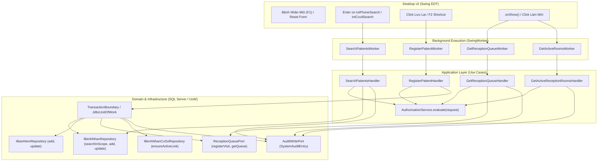
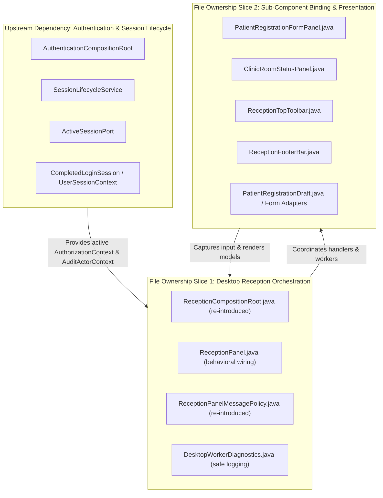

# Restored Desktop: Reception Wiring and Behavioral Reconciliation Map

Review dates: 2026-11-07 (Asia/Ho_Chi_Minh).  
Scope: Static source review, architectural comparison, and behavioral reconciliation for the patient reception module (`clinic-desktop`).  
Comparison revisions: Original restored desktop `982c1f6` (byte-identical to `main` baseline `6aabb85`), pre-restoration feature tree `63c6d71`, and current backend contracts in `clinic-application`, `clinic-domain`, and `clinic-infrastructure`.  
Assigned file: `docs/ke-hoach-trien-khai/desktop-main-reception-wiring-review.md`.  
**Notice:** This is an analytical and architectural report only; **no visual or runtime acceptance is claimed**, and no edits outside this assigned Markdown document are made.

---

## 1. Executive Source Map

This source map connects the restored Swing UI controls (`982c1f6`) with the pre-restoration wiring patterns (`63c6d71`) and the authoritative current backend application handlers, commands, queries, role permissions, data scopes, and audit boundaries.

| Restored UI Controls (`982c1f6`) | Pre-Restore Wiring (`63c6d71`) | Current Application Handler & Port | Role & Action Boundary | Data Scope Boundary | Audit Action & Commit Semantics |
|---|---|---|---|---|---|
| **Patient Search Bar** `txtPhoneSearch`, `txtCccdSearch` ([`PatientRegistrationFormPanel.java:88-101`](../../clinic-desktop/src/main/java/vn/clinicmanagement/desktop/modules/reception/components/PatientRegistrationFormPanel.java#L88-L101)) | Asynchronous `SwingWorker` triggered on Enter/Search; pre-check keyword, populate form on selection | [`SearchPatientsHandler`](../../clinic-application/src/main/java/vn/clinicmanagement/application/reception/SearchPatientsHandler.java#L16) Query: [`SearchPatientsQuery`](../../clinic-application/src/main/java/vn/clinicmanagement/application/reception/SearchPatientsQuery.java#L10) | `PATIENT:XEM` (Module: `PATIENT`, Action: `XEM`) | `KHOA_PHONG`: Exact `facilityId` + `departmentId`; limits to 50 scoped rows | `AuditActionCode.PATIENT_SEARCH` Committed **before** returning data. Fail-closed: audit write failure returns `PATIENT_SEARCH_FAILED`. Unauthenticated/unauthorized returns `AUTH_ACCESS_DENIED`. |
| **Patient Registration & Save** Form Demographics, BHYT fields, Footer `btnSave` (F2) ([`ReceptionFooterBar.java:29,42-50`](../../clinic-desktop/src/main/java/vn/clinicmanagement/desktop/modules/reception/components/ReceptionFooterBar.java#L29)) | Form extraction to command; background `SwingWorker`; duplicate CCCD intercept; form retain | [`RegisterPatientHandler`](../../clinic-application/src/main/java/vn/clinicmanagement/application/reception/RegisterPatientHandler.java#L33) Command: [`RegisterPatientCommand`](../../clinic-application/src/main/java/vn/clinicmanagement/application/reception/RegisterPatientCommand.java#L13) | New patient: `PATIENT:TAO` + `RECEPTION:TAO` Existing patient: `PATIENT:SUA` + `RECEPTION:TAO` | `KHOA_PHONG`: Actor, target room, and patient scope must strictly match `facilityId` + `departmentId` | `AuditActionCode.PATIENT_CREATED` or `PATIENT_UPDATED`, `INSURANCE_CREATED` or `INSURANCE_UPDATED`, `VISIT_REGISTERED`. All mutations and audit records committed within the same atomic `TransactionBoundary`. Failure rolls back all. |
| **Active Room Catalog** `chooserClinicRoom` ([`PatientRegistrationFormPanel.java:286-296`](../../clinic-desktop/src/main/java/vn/clinicmanagement/desktop/modules/reception/components/PatientRegistrationFormPanel.java#L286-L296)) | Loaded dynamically during view initialization and refresh; bound to popup chooser | [`GetActiveReceptionRoomsHandler`](../../clinic-application/src/main/java/vn/clinicmanagement/application/reception/GetActiveReceptionRoomsHandler.java#L16) Query: [`GetActiveReceptionRoomsQuery`](../../clinic-application/src/main/java/vn/clinicmanagement/application/reception/GetActiveReceptionRoomsQuery.java#L11) | `CATALOG:XEM` (Module: `CATALOG`, Action: `XEM`) | `KHOA_PHONG`: Active rooms matching `facilityId` + `departmentId` | `AuditActionCode.CATALOG_VIEW` Committed before response. Fail-closed if audit fails. |
| **Queue & Room Status** Tab 0 Queue Table & Tab 2 3-Column Status ([`ClinicRoomStatusPanel.java:75-224`](../../clinic-desktop/src/main/java/vn/clinicmanagement/desktop/modules/reception/components/ClinicRoomStatusPanel.java#L75-L224)) | Loaded on `onShow()`, "Làm Mới", and after registration; populates queue and summary models | [`GetReceptionQueueHandler`](../../clinic-application/src/main/java/vn/clinicmanagement/application/reception/GetReceptionQueueHandler.java#L14) Query: [`GetReceptionQueueQuery`](../../clinic-application/src/main/java/vn/clinicmanagement/application/reception/GetReceptionQueueQuery.java#L10) | `RECEPTION:XEM` (Module: `RECEPTION`, Action: `XEM`) | `KHOA_PHONG`: `LocalDate.now()`, `facilityId` + `departmentId` | `AuditActionCode.PATIENT_VIEW` Committed before response. Fail-closed if audit fails. |

---

## 2. Detailed Architectural Comparison: Restored `982c1f6` vs. Pre-Restore `63c6d71`

The desktop restoration commit `982c1f6` reverted `clinic-desktop` back to the pristine visual design of `6aabb85`. While this preserved the Owner's exact UI layouts, fonts, and styling, it re-introduced prototype wiring and removed the orchestration layer that had connected the desktop to the real backend.

### 2.1. Component-by-Component Comparison

#### 2.1.1. `ReceptionPanel`
* **Restored (`982c1f6` / `6aabb85`):**
  * Constructed with `ReceptionTopToolbar`, `PatientRegistrationFormPanel`, `ClinicRoomStatusPanel`, and `ReceptionFooterBar` in a `BorderLayout` with vertical `JSplitPane` (divider at 218px) ([`ReceptionPanel.java:27-54`](../../clinic-desktop/src/main/java/vn/clinicmanagement/desktop/modules/reception/ReceptionPanel.java#L27-L54)).
  * Synchronizes room selection between form and status panel (`formPanel.setOnClinicRoomChanged(...)` at line 41).
  * `refreshData()` is a complete stub (`// Dữ liệu sẵn sàng nạp từ Domain / Application Service` at lines 62-64).
  * No dependency injection, no composition root reference, and no session awareness.
* **Pre-Restoration (`63c6d71`):**
  * `ReceptionCompositionRoot` assembled `RegisterPatientHandler`, `SearchPatientsHandler`, `GetReceptionQueueHandler`, and `GetActiveReceptionRoomsHandler` using shared connection, transaction manager, and audit writer.
  * `ReceptionPanel` maintained an active `SessionLifecycleService` listener. When the session locked, expired, or logged out, background workers were safely canceled, and in-flight mutations were discarded.
  * Contained asynchronous `SwingWorker` implementations for search, registration, room catalog loading, and queue synchronization, offloading all I/O from the Swing Event Dispatch Thread (EDT).
  * Incorporated `ReceptionPanelMessagePolicy` to translate backend `Result` error codes into user-safe, localized dialog messages without exposing raw exception text or database schema details.

#### 2.1.2. `PatientRegistrationFormPanel`
* **Restored (`982c1f6` / `6aabb85`):**
  * Features complete demographic input fields (Mã BN, Họ tên, Giới tính, Ngày sinh, Nơi sinh, Thôn/phố, Nghề nghiệp, Điện thoại, Email, Dân tộc, Quốc tịch, CCCD, Ngày cấp, Nơi cấp, Nơi làm việc) and insurance fields (Số BHYT, Nơi sống, KCBBĐ, Hạn thẻ, Tuyến KCB, v.v.).
  * Hardcoded demonstration values are embedded directly in component initializers: e.g., Mã BN `"22000326"`, Họ tên `"NGUYỄN THỊ LIÊN"`, Ngày sinh `"25/10/2000"`, Nơi sinh `"bắc ninh"`, Điện thoại `"012345678"`, CCCD `"111122222333"` ([`PatientRegistrationFormPanel.java:150,155,171-173,188,211,232`](../../clinic-desktop/src/main/java/vn/clinicmanagement/desktop/modules/reception/components/PatientRegistrationFormPanel.java#L150)).
  * Service chooser uses static string array `CLINICAL_SERVICES` (13 items); Room chooser uses static string array `CLINIC_ROOMS` (17 items) ([lines 19-53](../../clinic-desktop/src/main/java/vn/clinicmanagement/desktop/modules/reception/components/PatientRegistrationFormPanel.java#L19-L53)).
  * Search bar controls (`txtPhoneSearch`, `txtCccdSearch`) have no action listeners attached.
* **Pre-Restoration (`63c6d71`):**
  * Implemented bidirectional data binding between UI components and the `PatientRegistrationDraft` / `RegisterPatientCommand`.
  * Covered by `PAT-FIELDS-01` (`b92efd0`), verifying all 15 demographic form fields map accurately into domain entities and SQL persistence.
  * Form search bar was wired to search workers. Selecting a search match populated all 15 administrative fields plus existing insurance cards, setting `patient.id` for an update flow rather than an insert.
  * Intercepted `PATIENT_DUPLICATE_CCCD` results with a specialized dialog offering to search and switch to the existing patient record while retaining entered draft data.

#### 2.1.3. `ClinicRoomStatusPanel`
* **Restored (`982c1f6` / `6aabb85`):**
  * 9 horizontal tabs ("DS Đăng Ký Khám", "Lịch Sử Khám Và Điều Trị", "Trạng Thái Phòng Khám", "Sinh Hiệu", "Zalo", "Thông Tin Xác Thực", "Gia Đình", "Quân Nhân", "Ghi Chú") ([`ClinicRoomStatusPanel.java:231-241`](../../clinic-desktop/src/main/java/vn/clinicmanagement/desktop/modules/reception/components/ClinicRoomStatusPanel.java#L231-L241)).
  * Tab 0 ("DS Đăng Ký Khám") contains a single hardcoded sample row: `"10:39 23/08/2022 | 2 | Chờ khám"` ([line 95](../../clinic-desktop/src/main/java/vn/clinicmanagement/desktop/modules/reception/components/ClinicRoomStatusPanel.java#L95)).
  * Tab 2 ("Trạng Thái Phòng Khám") uses hardcoded 2D arrays (`getColumn1Data()` with 20 rooms, `getColumn2Data()` with 19 rooms, and column 3 with 20 empty rows) ([lines 369-441](../../clinic-desktop/src/main/java/vn/clinicmanagement/desktop/modules/reception/components/ClinicRoomStatusPanel.java#L369-L441)). Red color highlighting for `"Phòng Tiêm Chủng"` is hardcoded in the renderer ([lines 166-186](../../clinic-desktop/src/main/java/vn/clinicmanagement/desktop/modules/reception/components/ClinicRoomStatusPanel.java#L166-L186)).
  * Tabs 1 and 3-8 switch to Tab 0's view or remain non-functional.
* **Pre-Restoration (`63c6d71`):**
  * Tab 0 table was backed by a dynamic `DefaultTableModel` populated with `ReceptionQueueItem` instances from `GetReceptionQueueHandler`.
  * Tab 2 was dynamically populated from `ReceptionRoomSummary` objects, accurately reflecting live room occupancy (`daDangKy`, `choKham`, `dangKham`).
  * Dynamic room selection highlighting responded to `setSelectedClinicRoom(String roomName)` when the operator chose a room on the registration form.

#### 2.1.4. `ReceptionTopToolbar` and `ReceptionFooterBar`
* **Restored (`982c1f6` / `6aabb85`):**
  * Top toolbar Megaphone button ("Gọi Số Tiếp Theo") pops up a mock `JOptionPane`: `"Hệ thống tự động phát loa gọi số thứ tự tiếp theo tại Cửa số 2: \"Xin mời số thứ tự 22000326 vào cửa số 2 tiếp đón!\""` ([`ReceptionTopToolbar.java:88-92`](../../clinic-desktop/src/main/java/vn/clinicmanagement/desktop/modules/reception/components/ReceptionTopToolbar.java#L88-L92)).
  * Footer bar "Lưu Lại (F2)" button pops up a mock `JOptionPane`: `"Lưu thành công hồ sơ đăng ký khám cho bệnh nhân NGUYỄN THỊ LIÊN!..."` ([`ReceptionFooterBar.java:43-49`](../../clinic-desktop/src/main/java/vn/clinicmanagement/desktop/modules/reception/components/ReceptionFooterBar.java#L43-L49)).
  * Buttons "Menu", "In", "Làm Mới", "Bệnh Nhân Mới", "Nhập Thẻ BH", "Kiểm Tra Thẻ BH", "In Phiếu Khám (F3)", and "Thẻ KCB (F4)" have no wired event handlers.
* **Pre-Restoration (`63c6d71`):**
  * "Lưu Lại (F2)" triggered form validation, constructed `RegisterPatientCommand`, and dispatched it via `SwingWorker` to `RegisterPatientHandler`.
  * "Làm Mới" invoked `refreshData()` to reload queue and active room summaries.
  * "Bệnh Nhân Mới (F1)" cleared form inputs and reset patient state to ready for intake.

### 2.2. Removed Test Suite Evidence
The restoration at `982c1f6` deleted 21 desktop test files. Key reception-related test suites that verified protected wiring prior to the restore include:
1. `PatientRegistrationFormPanelTest`: Headless validation of form-to-command field mappings, birthdate calculations, and room selection callbacks.
2. `ReceptionPanelSessionListenerTest`: Validated that session lock, timeout, and logout cleared form drafts, halted running workers, and prevented cross-tenant data leaks.
3. `ReceptionSqlServerPersistenceTest`: Opt-in SQL Server integration test verifying registration, CCCD uniqueness conflict, BHYT persistence, and queue read-back.
4. `ReceptionSqlServerProcessRestartTest`: Multi-JVM restart probe verifying persistence across desktop process lifecycles.
5. `ReceptionPanelMessagePolicyTest`: Verified that business error codes (`PATIENT_VALIDATION`, `PATIENT_DUPLICATE_CCCD`, `ROOM_UNAVAILABLE`, `SCOPE_MISMATCH`, etc.) map to sanitized Vietnamese user messages.

---

## 3. Protected Use Case and Callback Mapping

To re-establish reception functionality safely without redesigning visual components, the original UI callbacks must be mapped to current application use case handlers while adhering strictly to clean architecture, role/scope authorization, and transaction-bound audit logging.

### 3.1. Patient Search Callback (`SearchPatientsHandler`)
* **Trigger:** Pressing Enter in `txtPhoneSearch` or `txtCccdSearch` in the top search bar.
* **Input Extraction:** Trims and sanitizes input text. Rejects blank search requests immediately with localized validation failure (`"SEARCH_KEYWORD_REQUIRED"`).
* **Application Query:** `SearchPatientsQuery(keyword, authorizationContext, auditActorContext)`.
* **Authorization & Role Boundary:**
  * Requires active session context.
  * Evaluated via `ReceptionReadAudit.evaluate(context, actor, authorization, "PATIENT")`.
  * Verified for module `"PATIENT"` with action `HanhDongQuyen.XEM`.
  * Operator role must be in approved allowlist (e.g., `RECEPTIONIST`).
* **Data Scope:** Enforces `KHOA_PHONG` boundary. `patients.searchInScope(keyword, facilityId, departmentId, 50)` ensures only patients linked to the authenticated facility/department are retrieved.
* **Audit Boundary:**
  * Success: Commits `AuditActionCode.PATIENT_SEARCH` with `AuditOutcome.SUCCESS` via `audit.appendIndependently(...)` **before** returning search results.
  * Audit Failure: Fail-closed. If appending audit fails, the handler catches the exception and returns failure `PATIENT_SEARCH_FAILED` (`"Không thể tìm hồ sơ lúc này. Hãy kiểm tra kết nối cơ sở dữ liệu."`).
  * Unauthorized: Commits `AuditActionCode.AUTH_ACCESS_DENIED` with outcome `DENIED` and reason `AUTH_FORBIDDEN` or `SCOPE_MISMATCH`.
* **UI Dispatch (EDT):** `done()` method handles results. If matches found, displays results in a search popup or populates form directly if exact match; if empty, notifies user while retaining entered query; on error, surfaces sanitized error dialog.

### 3.2. Patient Registration Callback (`RegisterPatientHandler`)
* **Trigger:** Click on `btnSave` ("Lưu Lại (F2)") in `ReceptionFooterBar` or pressing `F2`.
* **Input Extraction:** Gathers 15 demographic fields, BHYT fields, and visit parameters (`doiTuongKham`, `uuTien`, `cbDkKham`, `txtReason`, selected `roomId`).
* **Application Command:** `RegisterPatientCommand(patient, insurance, roomId, registrationType, reason, payerType, priority, createdBy, authorizationContext, auditActorContext)`.
* **Authorization & Role Boundary:**
  * Checks existing vs new: `boolean existing = patient.getId() != null && patient.getId() > 0`.
  * New record: Requires `PATIENT:TAO` and `RECEPTION:TAO`.
  * Existing record: Requires `PATIENT:SUA` and `RECEPTION:TAO`.
  * Requires `createdBy == authorizationContext.employeeId()`.
* **Data Scope Boundary:**
  * Room scope validation: `room.getKhoa().getCoSo().getId() == context.facilityId()` and `room.getKhoa().getId() == context.departmentId()`. Target room must belong to the active facility and department.
  * Existing patient scope check: `patients.getByIdInScope(patient.getId(), context.facilityId(), context.departmentId())`. Updating a patient outside scope returns `SCOPE_MISMATCH`.
* **Phone Number Invariant (DEC-VO-01):**
  * `patient.dienThoai` and `patient.nguoiLienHeDienThoai` are normalized via `PhoneNumber.getValue()` prior to database persistence.
  * Allowed separators (spaces, dots, hyphens) are stripped; national prefixes (`0` or `+84`) are strictly preserved.
  * Raw entered phone strings are never surfaced in audit or error logs.
* **Audit & Transaction Boundary:**
  * Executed within `transactions.inTransaction(...)`:
    1. Patient insert or update: Emits `AuditActionCode.PATIENT_CREATED` or `AuditActionCode.PATIENT_UPDATED` (Resource: `PATIENT`).
    2. Insurance card insert or update: Emits `AuditActionCode.INSURANCE_CREATED` or `AuditActionCode.INSURANCE_UPDATED` (Resource: `INSURANCE`).
    3. Visit creation: `receptionQueue.registerVisit(...)` allocates STT and queue entry; emits `AuditActionCode.VISIT_REGISTERED` (Resource: `VISIT`).
    4. Patient-Facility idempotent link: `patientFacilities.ensureActiveLink(patient.getId(), context.facilityId(), context.employeeId())` creates or preserves active `BenhNhanCoSo` record (enforcing Migration V9 unique index).
  * Transaction Atomicity: All SQL writes and system audit entries share the same transaction. A failure in any step (including audit write failure) triggers a full rollback.
* **Error Intercepts:**
  * Duplicate CCCD (`PatientIdentityConflictException`): Caught and mapped to `PATIENT_DUPLICATE_CCCD`. UI retains entered form data and prompts user to search existing profile.
  * Validation error: Mapped to `PATIENT_VALIDATION` with specific field message.
  * Room unavailable: Mapped to `ROOM_UNAVAILABLE`.

### 3.3. Active Room Catalog Callback (`GetActiveReceptionRoomsHandler`)
* **Trigger:** Initialization of `ReceptionPanel`, invoking "Làm Mới" on toolbar, or opening room popup chooser.
* **Application Query:** `GetActiveReceptionRoomsQuery(authorizationContext, auditActorContext)`.
* **Authorization & Role Boundary:** Evaluated for module `"CATALOG"` with action `HanhDongQuyen.XEM`.
* **Data Scope:** Scoped by `facilityId` and `departmentId`. Executes `rooms.getActiveRoomsInScope(facilityId, departmentId)`. Inactive or soft-deleted rooms are excluded.
* **Audit Boundary:** Appends `AuditActionCode.CATALOG_VIEW` before returning room list. Fail-closed on audit failure.
* **UI Dispatch:** Updates items in `chooserClinicRoom` on `PatientRegistrationFormPanel`.

### 3.4. Reception Queue & Room Status Callback (`GetReceptionQueueHandler`)
* **Trigger:** View activation (`onShow()`), clicking "Làm Mới" on toolbar, or following successful patient registration.
* **Application Query:** `GetReceptionQueueQuery(date, authorizationContext, auditActorContext)` where date defaults to `LocalDate.now()`.
* **Authorization & Role Boundary:** Evaluated for module `"RECEPTION"` with action `HanhDongQuyen.XEM`.
* **Data Scope:** Scoped to today's date, `context.facilityId()`, and `context.departmentId()`.
* **Audit Boundary:** Appends `AuditActionCode.PATIENT_VIEW` before returning data snapshot. Fail-closed on audit failure.
* **UI Dispatch:**
  * Tab 0 ("DS Đăng Ký Khám"): Populates queue table with patient sequence numbers, registration times, and waiting statuses (`CHO_KHAM`).
  * Tab 2 ("Trạng Thái Phòng Khám"): Updates 3-column room status table with current counts (`daDangKy`, `choKham`, `dangKham`).

---

## 4. Control Inventory: Demo vs. Wired Status

The following matrix provides an exhaustive categorization of every control across the four reception UI panels, specifying its current demonstration behavior and its target production wiring.

| Panel / Component | Control Label / Symbol | Current State in `982c1f6` | Target Behavioral Wiring | Status / Phase |
|---|---|---|---|---|
| **`ReceptionTopToolbar`** | "Menu" | Unwired action button | Context menu popup placeholder | `[ ] Demo / Future` |
| **`ReceptionTopToolbar`** | "In" | Unwired action button | Print receipt / report dialog | `[ ] Demo (Phase 7)` |
| **`ReceptionTopToolbar`** | "Làm Mới" | Unwired action button | Trigger `refreshData()` (reload queue & active rooms via background worker) | `[~] Needs Wiring` |
| **`ReceptionTopToolbar`** | "Bệnh Nhân Mới" | Unwired action button | Reset form, clear patient ID, reset date/time to now, clear validation styles | `[~] Needs Wiring` |
| **`ReceptionTopToolbar`** | "Nhập Thẻ BH" | Unwired action button | Set focus to first BHYT input segment | `[ ] Demo / Shortcut` |
| **`ReceptionTopToolbar`** | "Kiểm Tra Thẻ BH" | Unwired action button | External BHYT portal lookup (no reception adjudication per DEC-VO-01) | `[ ] Demo / Future` |
| **`ReceptionTopToolbar`** | "Cửa đón tiếp [ 2 ]" | Static yellow label | Workstation counter display (read-only station metadata) | `[x] Display Only` |
| **`ReceptionTopToolbar`** | "Gọi Số Tiếp Theo" (Loa) | Shows mock `JOptionPane` with hardcoded text | Automated audio queue calling system (PA speaker integration) | `[ ] Demo / Mock` |
| **`PatientRegistrationFormPanel`** | `cbDoiTuong` | Dropdown: Viện phí, BHYT, Dịch vụ | Maps to `DoiTuongKham` enum in registration command | `[~] Needs Wiring` |
| **`PatientRegistrationFormPanel`** | `chkUuTien` | Checkbox: "ĐN vn tiền" (Red) | Maps to `priority` boolean in registration command | `[~] Needs Wiring` |
| **`PatientRegistrationFormPanel`** | `txtPhoneSearch` | Unwired text field (width 80) | Patient phone search trigger (Enter key dispatches `SearchPatientsQuery`) | `[~] Needs Wiring` |
| **`PatientRegistrationFormPanel`** | `txtCccdSearch` | Unwired text field (width 110) | Patient CCCD search trigger (Enter key dispatches `SearchPatientsQuery`) | `[~] Needs Wiring` |
| **`PatientRegistrationFormPanel`** | 15 Demographic Fields | Hardcoded strings ("22000326", "NGUYỄN THỊ LIÊN", etc.) | Data-bound to `BenhNhan` entity and `RegisterPatientCommand` | `[~] Needs Wiring` |
| **`PatientRegistrationFormPanel`** | `lblAge` ("22 tuổi") | Static blue label | Dynamically computed from birth date day/month/year inputs | `[~] Needs Wiring` |
| **`PatientRegistrationFormPanel`** | `btnBrowse` ("...") | Unwired browse button | Address / administrative catalog search dialog | `[ ] Demo / Future` |
| **`PatientRegistrationFormPanel`** | `btnTtKhac` ("TT khác") | Unwired small button | Extended administrative information dialog | `[ ] Demo / Future` |
| **`PatientRegistrationFormPanel`** | `cbDkKham` | Dropdown: Khám bệnh, Tái khám, Cấp cứu | Maps to `registrationType` in `RegisterPatientCommand` | `[~] Needs Wiring` |
| **`PatientRegistrationFormPanel`** | `txtTime` | Static string ("10:39 23/08/2022") | Initialized to current system time (`LocalDateTime.now()`) | `[~] Needs Wiring` |
| **`PatientRegistrationFormPanel`** | `txtReason` | Static string ("đau mỏi") | Maps to `reason` in `RegisterPatientCommand` | `[~] Needs Wiring` |
| **`PatientRegistrationFormPanel`** | `chooserService` | Static chooser (`CLINICAL_SERVICES`) | Service selector; focuses room chooser and highlights yellow | `[~] Needs Wiring` |
| **`PatientRegistrationFormPanel`** | `chooserClinicRoom` | Static chooser (`CLINIC_ROOMS`) | Dynamically populated from `GetActiveReceptionRoomsHandler` | `[~] Needs Wiring` |
| **`PatientRegistrationFormPanel`** | BHYT Fields (11 inputs) | Static inputs & checkboxes | Data-bound to `BaoHiem` entity in `RegisterPatientCommand` | `[~] Needs Wiring` |
| **`PatientRegistrationFormPanel`** | `lblRate` ("0%") | Static blue label | Calculated insurance coverage rate | `[ ] Demo / Future` |
| **`ClinicRoomStatusPanel`** | Tab 0: "DS Đăng Ký Khám" | 1 hardcoded row ("10:39...") | Dynamic table populated from `GetReceptionQueueHandler` | `[~] Needs Wiring` |
| **`ClinicRoomStatusPanel`** | Tab 2: "Trạng Thái Phòng Khám" | Static 3-column mock data | Dynamic 3-column status populated from room summaries | `[~] Needs Wiring` |
| **`ClinicRoomStatusPanel`** | Tabs 1, 3-8 (History, Vitals, etc.) | Non-functional tab buttons | Clinical / EMR workflows; strictly gated by DEC-AUTHZ-01 (Deny for Receptionist) | `[ ] Gated / Future` |
| **`ReceptionFooterBar`** | `btnNew` ("Bệnh Nhân Mới (F1)") | Unwired footer button | Reset form, clear patient ID, reset date/time | `[~] Needs Wiring` |
| **`ReceptionFooterBar`** | `btnSave` ("Lưu Lại (F2)") | Shows mock `JOptionPane` | Trigger validation and dispatch `RegisterPatientCommand` via `SwingWorker` | `[~] Needs Wiring` |
| **`ReceptionFooterBar`** | `btnPrint` ("In Phiếu Khám (F3)") | Unwired footer button | Print patient intake ticket / barcode | `[ ] Demo (Phase 7)` |
| **`ReceptionFooterBar`** | `btnCard` ("Thẻ KCB (F4)") | Unwired footer button | Barcode / QR chip reader scanner interface | `[ ] Demo / Hardware` |

---

## 5. File Ownership Slices and Authentication Dependency

To maintain clean separation of concerns and enable concurrent development without merge conflicts, reception restoration is decomposed into two independent file ownership slices governed by a shared authentication dependency.

### 5.1. Upstream Dependency: Authentication & Session Lifecycle
* **Context:** The codebase currently has three known compilation diagnostics in `AuthenticationCompositionRoot` and `LoginForm` resulting from the `982c1f6` desktop restore. A separate worker is addressing those compilation errors under `desktop-main-auth-compatibility-review.md`.
* **Contractual Invariant:** Reception wiring must **not** create ad-hoc mock authentication, bypass authorization, or hardcode employee/facility IDs.
* **Consumed Artifacts:**
  * `ActiveSessionPort`: Verifies the session is valid, active, unlocked, and unexpired.
  * `CompletedLoginSession`: Ingests `employeeId`, `roleId`, `roleCode`, `facilityId`, and `departmentId`.
  * `SessionLifecycleService`: Registers session listeners on `ReceptionPanel`. When an idle timeout, lock, or logout occurs, the reception panel must immediately cancel running background workers and clear in-memory patient drafts to prevent cross-operator data leakage.

### 5.2. File Ownership Slice 1: Desktop Reception Orchestration
* **Assigned Files:**
  * `clinic-desktop/src/main/java/vn/clinicmanagement/desktop/modules/reception/ReceptionCompositionRoot.java`
  * `clinic-desktop/src/main/java/vn/clinicmanagement/desktop/modules/reception/ReceptionPanel.java`
  * `clinic-desktop/src/main/java/vn/clinicmanagement/desktop/modules/reception/ReceptionPanelMessagePolicy.java`
  * `clinic-desktop/src/main/java/vn/clinicmanagement/desktop/core/diagnostics/DesktopWorkerDiagnostics.java`
* **Responsibilities:**
  1. Instantiates application use cases (`RegisterPatientHandler`, `SearchPatientsHandler`, `GetReceptionQueueHandler`, `GetActiveReceptionRoomsHandler`) with production repositories, `JdbcTransactionManager`, `AuditWritePort`, and `AuthorizationService`.
  2. Implements asynchronous `SwingWorker` coordination off the EDT, ensuring GUI responsiveness and presenting loading cursors.
  3. Coordinates session listener callbacks (session lock, unlock, expiration, logout).
  4. Implements safe exception handling and restricted diagnostic logging without leaking PII, CCCD, phone numbers, or database credentials.

### 5.3. File Ownership Slice 2: Sub-Component Binding & Presentation
* **Assigned Files:**
  * `clinic-desktop/src/main/java/vn/clinicmanagement/desktop/modules/reception/components/PatientRegistrationFormPanel.java`
  * `clinic-desktop/src/main/java/vn/clinicmanagement/desktop/modules/reception/components/ClinicRoomStatusPanel.java`
  * `clinic-desktop/src/main/java/vn/clinicmanagement/desktop/modules/reception/components/ReceptionTopToolbar.java`
  * `clinic-desktop/src/main/java/vn/clinicmanagement/desktop/modules/reception/components/ReceptionFooterBar.java`
* **Responsibilities:**
  1. Extracts user input into typed form draft DTOs and populates fields from search result entities.
  2. Implements field-level visual validation (highlighting invalid inputs with red borders).
  3. Binds queue and room summary data models into `JTable` models on `ClinicRoomStatusPanel`.
  4. Maintains visual synchronization: selecting a room highlights the corresponding room row in red in the status panel.

### 5.4. Strict Visual Preservation Guard
Under no circumstances may the visual hierarchy, component positions, fonts, or styling be altered:
* The vertical `JSplitPane` divider must remain fixed at **218 px** ([`ReceptionPanel.java:44`](../../clinic-desktop/src/main/java/vn/clinicmanagement/desktop/modules/reception/ReceptionPanel.java#L44)).
* The 9 horizontal tabs in `ClinicRoomStatusPanel` must retain their exact order and labels.
* Typography must strictly use `AppFonts` (`BODY`, `BODY_BOLD`, `SMALL`, `SMALL_BOLD`); colors must conform to `UIConstants`.
* Keyboard shortcuts (`F1`, `F2`, `F3`, `F4`, `F12`, `Enter`, `Esc`) must be preserved without collision.

---

## 6. Synthetic Acceptance & Verification Framework

To verify reception wiring without depending on external databases, live network services, or visual observation, all automated acceptance tests must use synthetic fixtures only.

> [!IMPORTANT]
> **Strict Test Isolation Contract:**  
> Automated unit and integration tests must **never** connect to or write to `clinicDb` on `localhost:1433`. `clinicDb` is strictly reserved for manual Owner visual smoke. Default Maven tests (`mvn test`, `mvn clean verify`) must remain 100% in-memory and synthetic. All SQL Server opt-in tests must target dedicated disposable databases matching `clinic_test_*` or `clinic_orchestrator_review_*` and enforce `assertFalse("clinicDb".equalsIgnoreCase(databaseName))`.

### 6.1. Component-Level Headless Unit Tests (In-Memory Synthetic)
* **`PatientRegistrationFormPanelTest` (Re-introduced):**
  * Assert all 15 demographic fields map accurately to `RegisterPatientCommand`.
  * Test age calculation: setting birth date `25/10/2000` updates `lblAge` to display `"22 tuổi"` (relative to reference clock).
  * Verify phone number cleaning: inputs like `"0912.345.678"` or `"+84 912 345 678"` are formatted canonically while invalid strings trigger validation errors.
  * Verify BHYT card parsing: verifies 15-character 4-segment card number concatenation and date range validation.
* **`ClinicRoomStatusPanelTest`:**
  * Assert `updateQueue(List<ReceptionQueueItem>)` correctly replaces model rows in Tab 0.
  * Assert `updateRoomSummaries(List<ReceptionRoomSummary>)` populates columns 1 and 2 in Tab 2.
  * Assert `setSelectedClinicRoom("PK Nhi 1")` activates red cell renderer highlighting on the matching row.

### 6.2. Orchestration and Error Boundary Tests (In-Memory Synthetic)
* **`ReceptionCompositionRootTest`:**
  * Verify all four handlers are constructed with shared Unit of Work, real audit writer, and default-deny authorization service.
* **`ReceptionPanelMessagePolicyTest` (Re-introduced):**
  * Assert `PATIENT_DUPLICATE_CCCD` returns user message prompting to search existing record, displaying masked CCCD (e.g., `"0010******01"`).
  * Assert `ROOM_UNAVAILABLE` displays `"Phòng khám không hoạt động hoặc chưa gắn với cơ sở/khoa."`.
  * Assert `AUTHORIZATION_DENIED` displays safe localized denial without internal permission tokens.
  * Assert `PATIENT_REGISTRATION_FAILED` displays generic safe retry message.
* **`ReceptionPanelSessionListenerTest` (Re-introduced):**
  * Simulate `SessionLifecycleEvent.LOCKED`: verify form inputs become read-only, pending workers cancel, and draft data is shielded.
  * Simulate `SessionLifecycleEvent.EXPIRED` / `LOGGED_OUT`: verify form fields are cleared and view returns to clean state.

### 6.3. Asynchronous Concurrency and EDT Safety Tests
* **`ReceptionWorkerEdtTest`:**
  * Verify all repository and handler calls execute off the EDT.
  * Verify that UI mutations (showing dialogs, setting table models) execute exclusively on the EDT via `SwingUtilities.invokeLater` or `SwingWorker.done()`.
  * Verify that fast tab switching during active search cancels the background worker and ignores stale query results.

### 6.4. Opt-In SQL Server Persistence Acceptance Matrix (Dedicated Test DB Only)
When explicitly executed against a synthetic database (e.g., `clinic_test_reception_20261107`), tests must verify:
1. **End-to-End Registration:** Inserts patient, insurance, visit, and active `BenhNhanCoSo` link in one transaction; verifies all audit trail records.
2. **Duplicate CCCD Rejection:** Concurrently registering two active patients with the same CCCD allows the first and triggers a rollback and `PatientIdentityConflictException` on the second.
3. **Multi-Table Rollback on Audit Failure:** Simulating an audit write failure rolls back patient, insurance, and visit rows completely.
4. **Scoped Read-Back:** Searches and queue reads restricted to active `facilityId` and `departmentId`.

---

## 7. Guidance and Evidence Sources

### Guidance Files Read:
1. `docs/PROJECT_CONVENTIONS.md` (Orchestrator baseline and working conventions)
2. `README.md` (System overview, multi-module structure, and database profile conventions)
3. `DOMAIN_ANALYSIS.md` (Core domain model, aggregate roots, entities, repositories, and DDD principles)
4. `ERD_DIAGRAM.md` (Entity relationship diagrams for patient, facility, examination, insurance, and audit)
5. `UI_CODING_STANDARDS.md` (Medical UX standards, keyboard-first navigation, Swing EDT concurrency, and reception layout specs)
6. `docs/UI_DOMAIN_MAPPING_ANALYSIS.md` (Clean architecture mapping between Desktop UI, Application Layer, and Domain)
7. `docs/ke-hoach-trien-khai/README.md` (Implementation roadmap and backlog index)
8. `docs/ke-hoach-trien-khai/00-hien-trang.md` (Current technical state and architectural principles)
9. `docs/ke-hoach-trien-khai/03-model-task-board.md` (Model task board, historical commit evidence, and gate definitions)
10. `docs/ke-hoach-trien-khai/phan-he/03-tiep-don-benh-nhan-nhan-su.md` (Vertical slice specification for patient registration and reception)
11. `docs/ke-hoach-trien-khai/phase2-implementation-contract.md` (Security implementation contract, role matrix, and audit policies)
12. `docs/ke-hoach-trien-khai/phase2-sec01-baseline-acceptance.md` (SEC-01 baseline gate definition and acceptance criteria)
13. `docs/ke-hoach-trien-khai/desktop-main-ui-preservation-review.md` (Visual baseline comparison of `6aabb85`, `63c6d71`, and `982c1f6`)
14. `docs/ke-hoach-trien-khai/desktop-main-auth-compatibility-review.md` (Authentication compatibility review for desktop restore)
15. `docs/ke-hoach-trien-khai/phase0-error-mapping-review.md` (Historical review of business error mapping and diagnostic logging)

### RAG Retrieval and Search Limits:
Tool discovery found no callable repository RAG connector exposed in this session. In accordance with the prompt guidance, analysis proceeded using the supplied task context, tracked repository documentation, and static source code inspection of `clinic-desktop`, `clinic-application`, `clinic-domain`, and `clinic-infrastructure`. No external networks or production databases were accessed. No visual or runtime acceptance is recorded.
