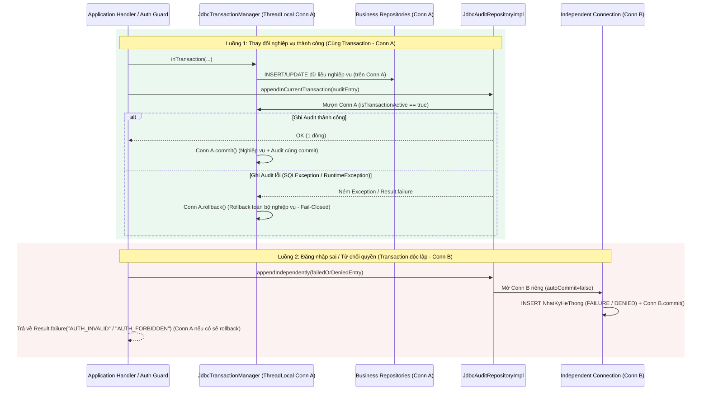

# Đề xuất Hợp đồng Triển khai Nhật ký Kiểm toán Bất biến (`SEC-AUDIT-01` Implementation Proposal)

> **Trạng thái tài liệu:** **`[ĐỀ XUẤT HỢP ĐỒNG KỸ THUẬT CHO SEC-AUDIT-01 — CHƯA TRIỂN KHAI CODE / TECHNICAL PROPOSAL — NO CODE CHANGES]`**  
> **Ngày lập:** 05/11/2026  
> **Căn cứ chính sách đã duyệt:** [`docs/ke-hoach-trien-khai/phase2-security-policy-proposal.md`](phase2-security-policy-proposal.md) (`L1-L66`) và [`docs/ke-hoach-trien-khai/phase2-implementation-contract.md`](phase2-implementation-contract.md) (`L1-L38`).  
> **Phạm vi thay đổi của task này:** Chỉ tạo duy nhất file `docs/ke-hoach-trien-khai/phase2-audit-implementation-proposal.md`. Không sửa mã nguồn Java, migration SQL, kiểm thử hay các tài liệu khác.  
> **Quy ước phân biệt Bằng chứng và Đề xuất:**
> - **`[Bằng chứng / Evidence]`**: Hiện trạng xác minh trực tiếp từ mã nguồn, schema SQL và tài liệu trong checkout kèm đường dẫn file và số dòng.
> - **`[Đề xuất / Proposal]`**: Thiết kế schema, API, ranh giới giao dịch (transaction boundary), quy tắc che giấu dữ liệu (redaction) và kế hoạch chia nhỏ task/test cho `SEC-AUDIT-01` tuân thủ chính sách đã duyệt.
> - **`[Ngoài phạm vi / Chờ Owner quyết định — Out of Scope / Pending Owner Decision]`**: Các chính sách chưa được Chủ dự án (Owner) phê duyệt — bao gồm cấp quyền `AUDIT_READ` cho vai trò cụ thể, thời hạn lưu trữ/xóa định kỳ (`retention/purge`), và khóa tài khoản khi đăng nhập sai (`login lockout`).

---

## 1. Tài liệu Hướng dẫn & Nguồn Mã nguồn Đã Đối chiếu

### 1.1. Tài liệu hướng dẫn bắt buộc đã đọc
1. **Quy ước nền của Orchestrator:** `docs/PROJECT_CONVENTIONS.md` (nạp trực tiếp trong gói task; bản sao tại đường dẫn file trong worktree chưa tồn tại).
2. **Tài liệu gốc của Repository:**
   - [`README.md`](../../README.md) (`L1-L24`)
   - [`DOMAIN_ANALYSIS.md`](../../DOMAIN_ANALYSIS.md) (`L1-L584`, đặc biệt Mục `2.1 BaseEntity` tại `L64-L68`, `2.16 domain.system` tại `L288-L298`, `2.17 domain.repositories` tại `L301-L315`)
   - [`ERD_DIAGRAM.md`](../../ERD_DIAGRAM.md) (`L1-L691`, đặc biệt `LuotKham ||--o{ NhatKyHoSoBenhAn` tại `L118` và định nghĩa `MaTranPhanQuyen`, `NhatKyHeThong`, `NhatKyHoSoBenhAn` tại `L649-L674`)
   - [`UI_CODING_STANDARDS.md`](../../UI_CODING_STANDARDS.md) (`L1-L663`, đặc biệt Mục `4.15` và `5.2.4 Xác nhận hành động nguy hiểm` tại `L516`)
   - [`PROJECT_COMPLETENESS_REPORT.md`](../../PROJECT_COMPLETENESS_REPORT.md) (`L1-L121`)
3. **Tài liệu Kế hoạch triển khai & Bảo mật Phase 2 (`docs/`):**
   - [`docs/ke-hoach-trien-khai/README.md`](README.md) (`L1-L50`)
   - [`docs/ke-hoach-trien-khai/00-hien-trang.md`](00-hien-trang.md) (`L1-L47`)
   - [`docs/ke-hoach-trien-khai/01-ma-tran-model-man-hinh.md`](01-ma-tran-model-man-hinh.md) (`L1-L34`)
   - [`docs/ke-hoach-trien-khai/02-cac-dot-trien-khai.md`](02-cac-dot-trien-khai.md) (`L1-L87`)
   - [`docs/ke-hoach-trien-khai/03-model-task-board.md`](03-model-task-board.md) (`L1-L89`, đặc biệt `SEC-01`, `SEC-AUDIT-DESIGN-01`, `AUD-01`)
   - [`docs/ke-hoach-trien-khai/phase2-security-policy-proposal.md`](phase2-security-policy-proposal.md) (`L1-L66`)
   - [`docs/ke-hoach-trien-khai/phase2-implementation-contract.md`](phase2-implementation-contract.md) (`L1-L38`)
   - [`docs/ke-hoach-trien-khai/phase2-auth-persistence-review.md`](phase2-auth-persistence-review.md) (`L1-L83`)
   - [`docs/ke-hoach-trien-khai/phase2-desktop-session-review.md`](phase2-desktop-session-review.md) (`L1-L44`)
   - [`docs/ke-hoach-trien-khai/phase2-domain-audit-review.md`](phase2-domain-audit-review.md) (`L1-L218`)
   - [`docs/ke-hoach-trien-khai/phase2-role-permission-matrix-proposal.md`](phase2-role-permission-matrix-proposal.md) (`L1-L264`)
   - [`docs/ke-hoach-trien-khai/phase0-domain-events-review.md`](phase0-domain-events-review.md) (`L1-L184`)
   - [`docs/ke-hoach-trien-khai/phase0-repository-contract-review.md`](phase0-repository-contract-review.md) (`L1-L60`)
   - [`docs/ke-hoach-trien-khai/phase0-error-mapping-review.md`](phase0-error-mapping-review.md) (`L1-L54`)
   - [`docs/ke-hoach-trien-khai/phan-he/03-tiep-don-benh-nhan-nhan-su.md`](phan-he/03-tiep-don-benh-nhan-nhan-su.md) đến [`09-danh-muc-bao-cao-tai-lieu.md`](phan-he/09-danh-muc-bao-cao-tai-lieu.md)
   - [`docs/AI_AGENT_PILOT_TASKS.md`](../AI_AGENT_PILOT_TASKS.md) (`L1-L120`)
   - *Lưu ý:* Các file `AGENTS.md`, `CONTRIBUTING.md`, `ARCHITECTURE.md`, `docs/DEVELOPMENT_CONVENTIONS.md`, `docs/README.md` không tồn tại trong worktree.

### 1.2. Mã nguồn và Migration đã phân tích
- **Domain & Ports (`clinic-domain`):** [`NhatKyHeThong.java`](../../clinic-domain/src/main/java/vn/clinicmanagement/domain/system/NhatKyHeThong.java) (`L1-L22`), [`NhatKyHoSoBenhAn.java`](../../clinic-domain/src/main/java/vn/clinicmanagement/domain/system/NhatKyHoSoBenhAn.java) (`L1-L22`), [`BaseEntity.java`](../../clinic-domain/src/main/java/vn/clinicmanagement/domain/common/BaseEntity.java) (`L1-L126`), [`IUnitOfWork.java`](../../clinic-domain/src/main/java/vn/clinicmanagement/domain/common/IUnitOfWork.java) (`L1-L6`), [`IRepository.java`](../../clinic-domain/src/main/java/vn/clinicmanagement/domain/repositories/IRepository.java) (`L1-L21`), [`ISystemRepository.java`](../../clinic-domain/src/main/java/vn/clinicmanagement/domain/repositories/ISystemRepository.java) (`L1-L9`), [`INhanVienRepository.java`](../../clinic-domain/src/main/java/vn/clinicmanagement/domain/repositories/INhanVienRepository.java) (`L1-L16`), [`IBenhNhanRepository.java`](../../clinic-domain/src/main/java/vn/clinicmanagement/domain/repositories/IBenhNhanRepository.java) (`L1-L10`), [`IBaoHiemRepository.java`](../../clinic-domain/src/main/java/vn/clinicmanagement/domain/repositories/IBaoHiemRepository.java) (`L1-L14`), [`IPhongKhamRepository.java`](../../clinic-domain/src/main/java/vn/clinicmanagement/domain/repositories/IPhongKhamRepository.java) (`L1-L11`), [`ILuotKhamRepository.java`](../../clinic-domain/src/main/java/vn/clinicmanagement/domain/repositories/ILuotKhamRepository.java) (`L1-L9`).
- **Application (`clinic-application`):** [`AuthenticateUserHandler.java`](../../clinic-application/src/main/java/vn/clinicmanagement/application/auth/AuthenticateUserHandler.java) (`L1-L94`), [`AuthenticateUserCommand.java`](../../clinic-application/src/main/java/vn/clinicmanagement/application/auth/AuthenticateUserCommand.java) (`L1-L22`), [`AuthenticatedUser.java`](../../clinic-application/src/main/java/vn/clinicmanagement/application/auth/AuthenticatedUser.java) (`L1-L38`), [`RegisterPatientHandler.java`](../../clinic-application/src/main/java/vn/clinicmanagement/application/reception/RegisterPatientHandler.java) (`L1-L113`), [`RegisterPatientCommand.java`](../../clinic-application/src/main/java/vn/clinicmanagement/application/reception/RegisterPatientCommand.java) (`L1-L12`), [`SearchPatientsHandler.java`](../../clinic-application/src/main/java/vn/clinicmanagement/application/reception/SearchPatientsHandler.java) (`L1-L33`), [`GetReceptionQueueHandler.java`](../../clinic-application/src/main/java/vn/clinicmanagement/application/reception/GetReceptionQueueHandler.java) (`L1-L22`), [`ReceptionQueuePort.java`](../../clinic-application/src/main/java/vn/clinicmanagement/application/reception/ReceptionQueuePort.java) (`L1-L16`), [`SessionTimeoutPolicy.java`](../../clinic-application/src/main/java/vn/clinicmanagement/application/session/SessionTimeoutPolicy.java) (`L1-L57`).
- **Infrastructure & SQL Migrations (`clinic-infrastructure`):** [`V1__Initial_Clinic_Schema.sql`](../../clinic-infrastructure/src/main/resources/migrations/V1__Initial_Clinic_Schema.sql) (`L1059-L1144`), [`V2__Seed_Initial_Data.sql`](../../clinic-infrastructure/src/main/resources/migrations/V2__Seed_Initial_Data.sql) (`L1-L150`), [`V3__Repair_Demo_Account_Passwords.sql`](../../clinic-infrastructure/src/main/resources/migrations/V3__Repair_Demo_Account_Passwords.sql) (`L1-L9`), [`V4__Enforce_Active_Patient_CCCD_Uniqueness.sql`](../../clinic-infrastructure/src/main/resources/migrations/V4__Enforce_Active_Patient_CCCD_Uniqueness.sql) (`L1-L29`), [`V5__Seed_Session_Timeout_Parameters.sql`](../../clinic-infrastructure/src/main/resources/migrations/V5__Seed_Session_Timeout_Parameters.sql) (`L1-L14`), [`DatabaseMigrationRunner.java`](../../clinic-infrastructure/src/main/java/vn/clinicmanagement/infrastructure/persistence/DatabaseMigrationRunner.java) (`L1-L198`), [`JdbcTransactionManager.java`](../../clinic-infrastructure/src/main/java/vn/clinicmanagement/infrastructure/persistence/JdbcTransactionManager.java) (`L1-L71`), [`JdbcConnectionProvider.java`](../../clinic-infrastructure/src/main/java/vn/clinicmanagement/infrastructure/persistence/JdbcConnectionProvider.java) (`L1-L38`), [`JdbcUnitOfWork.java`](../../clinic-infrastructure/src/main/java/vn/clinicmanagement/infrastructure/persistence/JdbcUnitOfWork.java) (`L1-L30`), [`SystemRepositoryImpl.java`](../../clinic-infrastructure/src/main/java/vn/clinicmanagement/infrastructure/persistence/system/SystemRepositoryImpl.java) (`L1-L65`), [`NhanVienRepositoryImpl.java`](../../clinic-infrastructure/src/main/java/vn/clinicmanagement/infrastructure/persistence/identity/NhanVienRepositoryImpl.java) (`L1-L370`), [`BenhNhanRepositoryImpl.java`](../../clinic-infrastructure/src/main/java/vn/clinicmanagement/infrastructure/persistence/patient/BenhNhanRepositoryImpl.java) (`L1-L309`), [`ReceptionQueueRepositoryImpl.java`](../../clinic-infrastructure/src/main/java/vn/clinicmanagement/infrastructure/persistence/reception/ReceptionQueueRepositoryImpl.java) (`L1-L153`).
- **Desktop (`clinic-desktop`):** [`UserSession.java`](../../clinic-desktop/src/main/java/vn/clinicmanagement/desktop/core/session/UserSession.java) (`L1-L125`), [`SessionLifecycleService.java`](../../clinic-desktop/src/main/java/vn/clinicmanagement/desktop/core/session/SessionLifecycleService.java) (`L1-L92`), [`LoginForm.java`](../../clinic-desktop/src/main/java/vn/clinicmanagement/desktop/modules/auth/LoginForm.java) (`L1-L179`), [`AuthenticationCompositionRoot.java`](../../clinic-desktop/src/main/java/vn/clinicmanagement/desktop/modules/auth/AuthenticationCompositionRoot.java) (`L1-L36`), [`ReceptionCompositionRoot.java`](../../clinic-desktop/src/main/java/vn/clinicmanagement/desktop/modules/reception/ReceptionCompositionRoot.java) (`L1-L28`).

---

## 2. Phân tích Hiện trạng theo Bằng chứng Mã nguồn (`[Bằng chứng / Evidence]`)

### 2.1. Hiện trạng Model `NhatKyHeThong`, `NhatKyHoSoBenhAn` và `BaseEntity`
1. **Model `NhatKyHeThong` ([`NhatKyHeThong.java:5-22`](../../clinic-domain/src/main/java/vn/clinicmanagement/domain/system/NhatKyHeThong.java#L5-L22)):**
   - **`[Bằng chứng / Evidence]`**: Kế thừa `BaseEntity<Integer>` (`L5`), không implement `IAggregateRoot`. Chỉ có 5 thuộc tính: `maNhanVien: Integer` (`L6`), `hanhDong: String = ""` (`L7`), `chiTiet: String = ""` (`L8`), `ipAddress: String` (`L9`), và `thoiGian: LocalDateTime = LocalDateTime.now()` (`L10`).
   - **Khoảng trống so với Policy đã duyệt ([`phase2-security-policy-proposal.md:41`](phase2-security-policy-proposal.md#L41)):**
     - Thiếu trường lưu vai trò hiệu lực (`roleId` / `roleCode`), phạm vi cơ sở/khoa hiệu lực (`facilityId`, `departmentId`), loại và mã bản ghi đích (`resourceType`, `resourceId`), kết quả thực thi (`result` / `outcome`), mã lý do (`reasonCode`), định danh máy trạm (`workstationId`) và mã tương quan/phiên (`correlationId` / `sessionId`).
     - Trường `thoiGian` khởi tạo bằng `LocalDateTime.now()` theo múi giờ cục bộ của JVM (`L10`), không đảm bảo chuẩn UTC đã duyệt.
     - Cung cấp các setter mở (`setMaNhanVien`, `setHanhDong`, `setChiTiet`, `setIpAddress`, `setThoiGian` tại `L13-L21`) và kế thừa toàn bộ các phương thức sửa/xóa mềm từ `BaseEntity` (`markAsUpdated`, `softDelete`, `restore` tại [`BaseEntity.java:68-88`](../../clinic-domain/src/main/java/vn/clinicmanagement/domain/common/BaseEntity.java#L68-L88)).

2. **Model `NhatKyHoSoBenhAn` ([`NhatKyHoSoBenhAn.java:5-22`](../../clinic-domain/src/main/java/vn/clinicmanagement/domain/system/NhatKyHoSoBenhAn.java#L5-L22)):**
   - **`[Bằng chứng / Evidence]`**: Kế thừa `BaseEntity<Integer>` (`L5`), không implement `IAggregateRoot`. Có 5 thuộc tính: `maLuotKham: int` (`L6`), `maNhanVien: int` (`L7`), `hanhDong: String = ""` (`L8`), `lyDo: String` (`L9`), và `thoiGian: LocalDateTime = LocalDateTime.now()` (`L10`).
   - **Khoảng trống so với Policy đã duyệt ([`phase2-security-policy-proposal.md:41`](phase2-security-policy-proposal.md#L41)):**
     - Thiếu vai trò hiệu lực (`roleId` / `roleCode`), phạm vi cơ sở/khoa hiệu lực (`facilityId`, `departmentId`), kết quả (`result`: `SUCCESS` / `DENIED` / `FAILURE`), mã lý do chuẩn hóa (`reasonCode` tách biệt hoặc ràng buộc độ dài/từ điển cho `lyDo`), `workstationId` và `correlationId`.
     - Trường `thoiGian` dùng `LocalDateTime.now()` (`L10`) thay vì UTC; kế thừa các hàm mutable/soft-delete của `BaseEntity` (`BaseEntity.java:53-88`).

### 2.2. Hiện trạng Schema SQL & Migration `V1`–`V5`
1. **Định nghĩa bảng trong `V1__Initial_Clinic_Schema.sql` ([`V1__Initial_Clinic_Schema.sql:1080-1117`](../../clinic-infrastructure/src/main/resources/migrations/V1__Initial_Clinic_Schema.sql#L1080-L1117)):**
   - **`[Bằng chứng / Evidence]`**:
     - `NhatKyHeThong` (`L1081-L1097`) có các cột nghiệp vụ: `id INT IDENTITY(1,1) PRIMARY KEY`, `maNhanVien INT NULL` (`FK_NhatKyHeThong_NhanVien`), `hanhDong NVARCHAR(255) NOT NULL`, `chiTiet NVARCHAR(MAX)`, `ipAddress VARCHAR(50)`, `thoiGian DATETIME2 NOT NULL DEFAULT GETDATE()`.
     - `NhatKyHoSoBenhAn` (`L1100-L1117`) có các cột nghiệp vụ: `id INT IDENTITY(1,1) PRIMARY KEY`, `maLuotKham INT NOT NULL` (`FK_NhatKyEMR_LuotKham`), `maNhanVien INT NOT NULL` (`FK_NhatKyEMR_NhanVien`), `hanhDong NVARCHAR(255) NOT NULL`, `lyDo NVARCHAR(500)`, `thoiGian DATETIME2 NOT NULL DEFAULT GETDATE()`.
     - Cả hai bảng đều khai báo đầy đủ nhóm cột mutable của `BaseEntity`: `version BIGINT NOT NULL DEFAULT 0`, `createdAt DATETIME2 NOT NULL DEFAULT GETDATE()`, `createdBy INT NULL`, `updatedAt DATETIME2 NULL`, `updatedBy INT NULL`, `isDeleted BIT NOT NULL DEFAULT 0`, `deletedAt DATETIME2 NULL`, `deletedBy INT NULL` (`L1088-L1095`, `L1107-L1114`).
     - Chưa có index truy vấn theo thời gian/nhân viên/lượt khám/mã tương quan cho hai bảng này tại phần tạo index cuối `V1` (`L1140-L1144`).
2. **Các migration `V2`–`V5` và `DatabaseMigrationRunner`:**
   - **`[Bằng chứng / Evidence]`**:
     - `V2__Seed_Initial_Data.sql` (`L1-L150`), `V3__Repair_Demo_Account_Passwords.sql` (`L1-L9`), `V4__Enforce_Active_Patient_CCCD_Uniqueness.sql` (`L1-L29`) và `V5__Seed_Session_Timeout_Parameters.sql` (`L1-L14`) không sửa đổi hay thêm cột/ràng buộc nào cho `NhatKyHeThong` và `NhatKyHoSoBenhAn`.
     - Tại snapshot trước follow-up, `DatabaseMigrationRunner.java` chỉ đăng ký V1–V4 dù V5 đã tồn tại. **Đã sửa sau snapshot đó:** commit `f75a672` thêm V5 sau V4; `FreshDatabaseMigrationSqlServerTest` hiện kỳ vọng V1–V5 và xác nhận hai timeout key mỗi key đúng một lần với giá trị 15/12. Root `mvn -Djava.awt.headless=true clean verify` pass; SQL Server opt-in chưa chạy. Migration audit tiếp theo phải đăng ký tuần tự sau V5.

### 2.3. Hiện trạng Quản lý Giao dịch (`JdbcTransactionManager`, `JdbcConnectionProvider`, `JdbcUnitOfWork`)
- **`[Bằng chứng / Evidence]`**:
  - [`JdbcTransactionManager.java:14-15`](../../clinic-infrastructure/src/main/java/vn/clinicmanagement/infrastructure/persistence/JdbcTransactionManager.java#L14-L15) giữ `ThreadLocal<Connection> currentConnection` và `ThreadLocal<Boolean> rollbackOnly`.
  - Khi gọi `inTransaction(Supplier<Result<T>> operation)` ở mức ngoài cùng (`L39-L62`):
    - Mở 1 `Connection` từ `connectionSupplier.get()` (`L39`), gọi `connection.setAutoCommit(false)` (`L40`), gắn vào `currentConnection` (`L41`) và thực thi `operation.get()` (`L44`).
    - Mọi repository gọi `connections.acquire()` ([`JdbcConnectionProvider.java:14-18`](../../clinic-infrastructure/src/main/java/vn/clinicmanagement/infrastructure/persistence/JdbcConnectionProvider.java#L14-L18)) trong cùng thread sẽ nhận `new Lease(transactionConnection, false)` — dùng chung `Connection` của giao dịch hiện tại và không đóng `Connection` khi thoát khối `try-with-resources` (`L35-L36`).
    - Nếu `result == null || result.isFailure() || rollbackOnly.get()` (`JdbcTransactionManager.java:45`), `JdbcTransactionManager` gọi `connection.rollback()` (`L46`). Nếu `operation.get()` ném `RuntimeException` hoặc `SQLException` (`L56-L57`), khối `try-with-resources` tự đóng `Connection` chưa commit và trả về `Result.failure("TRANSACTION_FAILED", ...)`.
  - Khi gọi `inTransaction` lồng nhau (`currentConnection.get() != null` tại `L28-L36`), `JdbcTransactionManager` **không** mở kết nối mới mà chạy trực tiếp trên `currentConnection` hiện hữu; nếu nhánh lồng nhau trả về `Result.isFailure()` hoặc ném `RuntimeException`, nó đặt `rollbackOnly.set(true)` (`L31, L34`), buộc giao dịch ngoài cùng phải `rollback()` (`L45-L50`).
  - Khi gọi `connections.acquire()` bên ngoài `inTransaction` (`transactions.currentConnection() == null` tại `JdbcConnectionProvider.java:15-17`), nó mở một `Connection` mới với `owned = true` (mặc định `autoCommit = true` của JDBC pool) và đóng ngay khi `Lease.close()`.

### 2.4. Hiện trạng Repository Ports, `AuthenticateUserHandler` và `RegisterPatientHandler`
1. **Repository Ports (`clinic-domain/repositories` & `clinic-application`):**
   - **`[Bằng chứng / Evidence]`**:
     - `IRepository<T extends BaseEntity<Integer> & IAggregateRoot>` ([`IRepository.java:10-21`](../../clinic-domain/src/main/java/vn/clinicmanagement/domain/repositories/IRepository.java#L10-L21)) bắt buộc có `add(T)`, `update(T)`, `delete(T)`. Do đó **không được dùng `IRepository<T>`** cho thực thể audit append-only.
     - `ISystemRepository` ([`ISystemRepository.java:6-9`](../../clinic-domain/src/main/java/vn/clinicmanagement/domain/repositories/ISystemRepository.java#L6-L9)) và [`SystemRepositoryImpl.java:17-65`](../../clinic-infrastructure/src/main/java/vn/clinicmanagement/infrastructure/persistence/system/SystemRepositoryImpl.java#L17-L65) hiện chỉ có `getMatrixByRoleId(int roleId)` và `getSystemParameterValue(String key)`. Hoàn toàn chưa có phương thức ghi hay đọc `NhatKyHeThong` hoặc `NhatKyHoSoBenhAn`.
2. **Luồng xác thực `AuthenticateUserHandler` ([`AuthenticateUserHandler.java:30-75`](../../clinic-application/src/main/java/vn/clinicmanagement/application/auth/AuthenticateUserHandler.java#L30-L75)) và `LoginForm` ([`LoginForm.java:103-164`](../../clinic-desktop/src/main/java/vn/clinicmanagement/desktop/modules/auth/LoginForm.java#L103-L164)):**
   - **`[Bằng chứng / Evidence]`**:
     - `AuthenticateUserHandler.handle` kiểm tra `command == null || command.username().isBlank()` (`L31`), tìm `employee = employees.getByUsername(command.username())` (`L38`), kiểm tra `employee == null || !employee.isHoatDong() || employee.isDeleted() || !passwordHasher.verify(...)` (`L39-L41` → trả về `AUTH_INVALID`), kiểm tra `roles.isEmpty()` (`L49-L51` → trả về `AUTH_NO_ROLE`) và `scopes.isEmpty()` (`L59-L61` → trả về `AUTH_NO_SCOPE`).
     - Ở cả 3 nhánh thất bại (`AUTH_INVALID`, `AUTH_NO_ROLE`, `AUTH_NO_SCOPE`), phương thức trả về `Result.failure(...)` ngay trước khi mở transaction, **chưa ghi bất kỳ dòng `NhatKyHeThong` nào**.
     - Khi credential và danh sách assignment hợp lệ, `AuthenticateUserHandler` gọi `transactions.inTransaction(() -> { employees.recordSuccessfulLogin(employee.getId(), LocalDateTime.now()); return Result.success(user); })` (`L65-L68`), nhưng tại thời điểm đó người dùng trên `LoginForm` **chưa chọn** `RoleChoice` và `WorkScopeChoice` (`LoginForm.java:139-146` mới mở hộp thoại chọn role/scope sau khi `authenticateUserHandler.handle` trả về!).
     - Theo [`phase2-implementation-contract.md:27`](phase2-implementation-contract.md#L27): *"Thiếu role hoặc scope bị từ chối trước khi ghi nhận đăng nhập thành công."* Hiện tại, nếu người dùng bấm Cancel ở hộp thoại chọn role/scope (`LoginForm.java:140, 142`), `dangNhapCuoi` trong DB đã bị cập nhật sớm từ bước `authenticateUserHandler.handle` và chưa có bản ghi audit gắn với `role` + `scope` đã chọn.
3. **Luồng tiếp đón `RegisterPatientHandler` ([`RegisterPatientHandler.java:35-85`](../../clinic-application/src/main/java/vn/clinicmanagement/application/reception/RegisterPatientHandler.java#L35-L85)):**
   - **`[Bằng chứng / Evidence]`**:
     - Thực thi trong một `transactions.inTransaction(...)` duy nhất (`L39-L84`): kiểm tra trùng CCCD (`L43-L46`), kiểm tra phòng khám (`L48-L52`), gọi `patients.update(patient)` hoặc `patients.add(patient)` (`L54-L55`), thêm/sửa `BaoHiem` (`L57-L68`), và gọi `receptionQueue.registerVisit(...)` (`L72-L74`).
     - Hiện chỉ nhận `int createdBy` từ `RegisterPatientCommand` (`RegisterPatientCommand.java:11`), chưa nhận ngữ cảnh phiên xác thực (`roleId`/`roleCode`, `facilityId`, `departmentId`, `workstationId`, `sessionId`/`correlationId`) và chưa ghi `NhatKyHeThong` cho thao tác tạo/cập nhật `BenhNhan`, `BaoHiem`, `LuotKham`.

---

## 3. Đề xuất Thiết kế Schema, API và Quy tắc Che giấu Dữ liệu (`[Đề xuất / Proposal]`)

### 3.1. Phân tích Rủi ro Tương thích Ngược & Thiết kế Schema Migration Nhỏ nhất An toàn
1. **Rủi ro từ các cột `BaseEntity` hiện có trên `NhatKyHeThong` và `NhatKyHoSoBenhAn`:**
   - **`[Bằng chứng / Evidence]`**: `V1__Initial_Clinic_Schema.sql` (`L1088-L1095`, `L1107-L1114`) đã tạo các cột `version`, `createdAt`, `createdBy`, `updatedAt`, `updatedBy`, `isDeleted`, `deletedAt`, `deletedBy` trên cả hai bảng audit.
   - **`[Đề xuất / Proposal]`**:
     - **Không `DROP COLUMN`** các cột `BaseEntity` đã phát hành ở `V1` để tránh phá vỡ schema hiện hữu và giữ tính tương thích ngược.
     - Thay vào đó, bổ sung **`CHECK` constraint** trên cả `NhatKyHeThong` và `NhatKyHoSoBenhAn` để giữ các cột trạng thái `BaseEntity` ở giá trị append-only:
       ```sql
       CONSTRAINT CK_NhatKyHeThong_AppendOnlyState CHECK (
           isDeleted = 0 AND updatedAt IS NULL AND updatedBy IS NULL
           AND deletedAt IS NULL AND deletedBy IS NULL AND version = 0
       )
       ```
       (và tương tự `CK_NhatKyHoSoBenhAn_AppendOnlyState` trên `NhatKyHoSoBenhAn`). Constraint này chỉ giữ `isDeleted`, `updatedAt`, `updatedBy`, `deletedAt`, `deletedBy`, `version` ở trạng thái cho phép; **nó không ngăn sửa `hanhDong`, `chiTiet`, `lyDo` hoặc metadata audit**. Không được xem riêng constraint này là bảo đảm append-only.
2. **Rủi ro khóa ngoại `maNhanVien INT NOT NULL` trên `NhatKyHoSoBenhAn` khi từ chối truy cập:**
   - **`[Bằng chứng / Evidence]`**: `NhatKyHoSoBenhAn.maNhanVien` là `INT NOT NULL` (`V1__Initial_Clinic_Schema.sql:1103`).
   - **`[Đề xuất / Proposal]`**:
     - Mọi thao tác chạm tới hồ sơ bệnh án (`VIEW_EMR`, `UPDATE_EMR`, `LOCK_EMR`, `REOPEN_EMR`, `PRINT_EMR`, `EXPORT_EMR`) chỉ xảy ra sau khi đã xác định `actorId` (`maNhanVien > 0`), nên `NhatKyHoSoBenhAn.maNhanVien` giữ nguyên `NOT NULL`. Nếu một yêu cầu bị từ chối vì không có ngữ cảnh xác thực (`unauthenticated` / `actorId == null`), sự kiện từ chối đó được ghi vào `NhatKyHeThong` (nơi `maNhanVien` là `INT NULL` tại `V1__Initial_Clinic_Schema.sql:1083`).
3. **Đề xuất Migration bổ sung metadata chuẩn UTC (`V6__Enhance_Audit_Tables_Append_Only.sql`):**
   - **`[Đề xuất / Proposal]`**: Bổ sung các cột metadata đã được duyệt tại [`phase2-security-policy-proposal.md:41`](phase2-security-policy-proposal.md#L41) vào `NhatKyHeThong` và `NhatKyHoSoBenhAn` với `NULL` hoặc `DEFAULT` an toàn để không làm hỏng dữ liệu hiện có:

| Cột bổ sung / chuẩn hóa | Bảng áp dụng | Kiểu SQL Server đề xuất | Ý nghĩa theo Policy đã duyệt (`phase2-security-policy-proposal.md:41`) |
|---|---|---|---|
| `maVaiTro` | Cả 2 bảng | `INT NULL` (`FK -> VaiTro(id)`) | ID vai trò hiệu lực trong phiên (`NULL` khi `AUTH_LOGIN_FAILED` trước lúc chọn role). |
| `maVaiTroCode` | Cả 2 bảng | `VARCHAR(50) NULL` | Mã vai trò hiệu lực tại thời điểm ghi (`ADMIN`, `DOCTOR`, `RECEPTIONIST`...) để giữ dấu vết lịch sử ngay cả khi bảng danh mục thay đổi. |
| `maCoSo` | Cả 2 bảng | `INT NULL` (`FK -> CoSo(id)`) | Cơ sở hiệu lực của phiên làm việc. |
| `maKhoa` | Cả 2 bảng | `INT NULL` (`FK -> Khoa(id)`) | Khoa hiệu lực của phiên làm việc. |
| `loaiDoiTuong` | `NhatKyHeThong` *(và tùy chọn trên `NhatKyHoSoBenhAn` mặc định `'LUOT_KHAM'`)* | `VARCHAR(100) NULL` | Loại bản ghi đích (`NHAN_VIEN`, `BENH_NHAN`, `BAO_HIEM`, `LUOT_KHAM`, `DON_THUOC`, `HOA_DON`, `MA_TRAN_PHAN_QUYEN`, `THAM_SO_HE_THONG`...). |
| `maDoiTuong` | `NhatKyHeThong` | `VARCHAR(100) NULL` | Định danh bản ghi đích (ID số chuyển thành chuỗi hoặc mã nghiệp vụ không chứa PII như `maThamSo`); trên `NhatKyHoSoBenhAn` đã có cột `maLuotKham INT NOT NULL`. |
| `ketQua` | Cả 2 bảng | `VARCHAR(30) NULL` cho legacy; mọi lần ghi mới phải truyền giá trị | Kết quả thao tác. Repository yêu cầu ghi rõ `SUCCESS`, `FAILURE` hoặc `DENIED`; `NULL` chỉ được giữ cho row cũ chưa phân loại, không gán ngầm thành công khi migration. Constraint cho phép `NULL` legacy hoặc ba mã hợp lệ. |
| `maLyDo` | Cả 2 bảng | `VARCHAR(100) NULL` | Mã lý do chuẩn hóa khi từ chối/thất bại hoặc mở/truy cập hồ sơ (`AUTH_INVALID`, `AUTH_NO_ROLE`, `AUTH_NO_SCOPE`, `AUTH_FORBIDDEN`, `SCOPE_MISMATCH`, `EMR_LOCKED`, `REOPEN_CLINICAL_ADDENDUM`...). |
| `workstationId` | Cả 2 bảng | `VARCHAR(100) NULL` | Mã máy trạm / quầy làm việc (`UserSession.workstationId` / `stationId` hoặc hostname rút gọn). |
| `correlationId` | Cả 2 bảng | `VARCHAR(100) NULL` | Mã tương quan của thao tác hoặc `sessionId` để liên kết chuỗi sự kiện trong cùng giao dịch/phiên. |
| `occurredAtUtc` | Cả 2 bảng | `DATETIME2(7) NULL` cho legacy; writer mới luôn ghi giá trị | Thời điểm event UTC có ngữ nghĩa rõ ràng. Giữ `thoiGian` tương thích ngược; không diễn giải hoặc chuyển đổi timestamp cũ từ `GETDATE()` vì không có offset lịch sử để xác định timezone. Tầng Application truyền UTC từ `Clock` (`Instant` → UTC). |

   - **Index chỉ đọc hỗ trợ truy vết tương lai (khi Owner cấp quyền):**
     - `IX_NhatKyHeThong_ThoiGian_NhanVien ON NhatKyHeThong(thoiGian DESC, maNhanVien, hanhDong)`
     - `IX_NhatKyHeThong_DoiTuong ON NhatKyHeThong(loaiDoiTuong, maDoiTuong, thoiGian DESC)`
     - `IX_NhatKyHoSoBenhAn_LuotKham_ThoiGian ON NhatKyHoSoBenhAn(maLuotKham, thoiGian DESC)`

### 3.2. Đề xuất Cưỡng chế Append-Only ở Tầng Ứng dụng và Giới hạn Thực tế
1. **Cưỡng chế Append-Only ở tầng Domain / Application / Infrastructure (`[Đề xuất / Proposal]`):**
   - **Không sử dụng `IRepository<T>`** cho audit vì `IRepository<T>` khai báo `update(T)` và `delete(T)` (`IRepository.java:18-19`).
   - Định nghĩa **cổng ghi kiểm toán bất biến riêng biệt (`AuditWritePort` / `IAuditRepository`)** chỉ có duy nhất các phương thức thêm mới (`appendSystemEvent`, `appendMedicalRecordEvent`):
     - Đầu vào là các `record` bất biến (`SystemAuditEntry`, `MedicalRecordAuditEntry`) được kiểm tra invariant ngay trong compact constructor (từ chối `null`/blank cho `actionCode`, `outcome`, `occurredAtUtc`, `correlationId`; kiểm tra bộ lọc redaction trước khi tạo).
     - `JdbcAuditRepositoryImpl` chỉ chứa câu lệnh `INSERT INTO NhatKyHeThong (...) VALUES (...)` và `INSERT INTO NhatKyHoSoBenhAn (...) VALUES (...)` với `isDeleted = 0, version = 0, updatedAt = NULL, updatedBy = NULL, deletedAt = NULL, deletedBy = NULL`. Không có bất kỳ câu lệnh `UPDATE`, `DELETE`, `TRUNCATE` hay `MERGE` nào trong adapter.
     - Đối với hai lớp `NhatKyHeThong` và `NhatKyHoSoBenhAn` hiện có trong `clinic-domain`: ghi đè (`@Override`) các phương thức `markAsUpdated(int)`, `softDelete(int)`, `restore()`, `setDeleted(boolean)`, `setUpdatedAt(LocalDateTime)`, `setUpdatedBy(Integer)`, `setDeletedAt(LocalDateTime)`, `setDeletedBy(Integer)` để ném `UnsupportedOperationException("Bản ghi nhật ký kiểm toán là bất biến (append-only); không cho phép sửa hoặc xóa.")` khi bị gọi.
2. **Giới hạn thực tế của cưỡng chế ở tầng ứng dụng (Không tự suy diễn giả định tài khoản DB):**
   - **`[Bằng chứng / Evidence]`**: Ứng dụng kết nối tới SQL Server qua một cấu hình nguồn dữ liệu duy nhất trong `DatabaseConnection.java` / `db.properties.example` (`README.md:7-10`), dùng chung cho cả `DatabaseMigrationRunner` và các repository lúc chạy.
   - **`[Giới hạn kỹ thuật / Technical Limitation]`**: Không tự giả định môi trường triển khai có tách riêng tài khoản SQL Server chỉ có quyền `INSERT` trên bảng audit. Khi ứng dụng dùng chung một DB login có quyền DDL/DML:
     - Constraint trạng thái `CHECK` chỉ chặn thay đổi làm sai các cột trạng thái đã liệt kê; nó **không** chặn `UPDATE chiTiet = ...` hoặc sửa đổi payload khác. Để đáp ứng append-only ở SQL Server khi chưa có bằng chứng về DB principal insert-only, đề xuất V6 tạo trigger `AFTER UPDATE, DELETE` trên cả hai bảng để `THROW` và rollback mọi UPDATE/DELETE. Kiểm thử phải thử cả sửa payload và soft-delete. Nếu Owner/vận hành chọn permission riêng chỉ cho `INSERT`, cần ghi nhận quyền thực thi đó trước khi coi bảo vệ DB đạt.
     - Trigger chặn DML thông thường trong ứng dụng/SQL session nhưng không chống được DB owner/`sysadmin`, người có thể vô hiệu hóa trigger hoặc sửa schema. Cấu hình principal riêng là hardening vận hành cần đánh giá tại `REL-01`.

### 3.3. Quy tắc Che giấu Dữ liệu Nhạy cảm (`AuditRedactor` Rules — `[Đề xuất / Proposal]`)
Tuân thủ nghiêm ngặt [`phase2-security-policy-proposal.md:41`](phase2-security-policy-proposal.md#L41) và [`phase2-implementation-contract.md:14`](phase2-implementation-contract.md#L14):
1. **Danh mục cấm tuyệt đối (Zero-Tolerance Denylist):**
   - Không bao giờ đưa vào `chiTiet`, `lyDo`, `maDoiTuong` hay thông báo lỗi:
     - Mật khẩu dạng rõ (`char[]` / `String`), `passwordHash` (`pbkdf2_sha256$...`), `token`, `apiKey`, `secretKey`, chuỗi kết nối JDBC (`jdbc:sqlserver://...`, `password=...`).
     - Số CCCD đầy đủ (`soCCCD` — chuỗi 9–12 chữ số liên tiếp), số thẻ BHYT đầy đủ (`soBaoHiem` — chuỗi 10–15 ký tự định danh thẻ), số điện thoại đầy đủ hoặc địa chỉ chi tiết của bệnh nhân.
     - Nội dung lâm sàng tự do (`lyDoKham`, `quaTrinhBenhLy`, `tienSuBanThan`, `tienSuGiaDinh`, `khamToanThan`, `khamBoPhan`, `tomTatBenhAn`, `huongDieuTri`, `loiDanBacSi`, `chanDoanText`, `ketQua`, `ketLuan`, `ghiChu`, `loiDanDonThuoc`).
2. **Bảo vệ chống lộ mật khẩu gõ nhầm vào ô `username` khi `AUTH_LOGIN_FAILED`:**
   - Khi đăng nhập thất bại do không tìm thấy tài khoản (`employee == null`), người dùng có thể đã vô tình gõ mật khẩu vào ô `username`.
   - **Quy tắc xử lý:**
     - Đặt `maNhanVien = NULL`, `maDoiTuong = NULL`.
     - Không ghi giá trị username thử đăng nhập, dù đã mask/hash, trong task đầu tiên. Ghi `maNhanVien = NULL` khi không tìm thấy tài khoản, cùng `hanhDong=AUTH_LOGIN_FAILED`, `ketQua=FAILURE`, `maLyDo=AUTH_INVALID` và correlation ID ngẫu nhiên của lần thử. Username bị lỗi định dạng cũng không được serialize; regex không thể nhận biết chắc chắn mật khẩu gõ nhầm.
3. **Định dạng `chiTiet` và `lyDo` tối thiểu:**
   - `NhatKyHeThong.chiTiet`: Chuỗi JSON phẳng từ schema/field allowlist (ví dụ: `{"changedFields":["dienThoai","diaChi"],"patientId":41,"visitId":91}`), tuyệt đối không serialize toàn bộ đối tượng `BenhNhan`, `BaoHiem`, `LuotKham` hay `SQLException.getMessage()`. Redactor/allowlist phải chặn dữ liệu tại nguồn; regex quét chuỗi tự do chỉ là defense-in-depth, không thay thế typed fields và explicit field mapping.
   - `NhatKyHoSoBenhAn`: Chỉ lưu định danh lượt khám/actor/scope, action, outcome, reason code và lý do nghiệp vụ đã được whitelist. Không nhận free-text lâm sàng; nếu cần lý do người dùng nhập thì phải có rule length/field-specific và không thể dùng regex làm bảo đảm duy nhất.

### 3.4. Quyền Tra cứu `AUDIT_READ` và Chính sách Lưu trữ (`Retention`)
- **`[Chính sách bắt buộc — Đã duyệt]`**:
  - Quyền tra cứu nhật ký kiểm toán (`AUDIT_READ` / phân hệ `AUDIT`) **giữ mặc định từ chối (`DEFAULT-DENY`, `duocPhep = false`) cho mọi vai trò**, kể cả `ADMIN` ([`phase2-implementation-contract.md:13,28,37`](phase2-implementation-contract.md#L13)).
  - Không tự gán quyền `AUDIT_READ` cho bất kỳ vai trò nào trong dữ liệu seed hay trong code.
  - Nếu có cổng đọc phục vụ kiểm thử kỹ thuật (`AuditReadPort`), cổng này phải bắt buộc đi qua bộ kiểm tra quyền `AuthorizationGuard.requirePermission(context, "AUDIT", "AUDIT_READ")` và mặc định trả về `Result.failure("AUTH_FORBIDDEN", ...)` cho mọi role hiện tại.
  - Chính sách lưu trữ giữ nguyên **không xóa / không dọn tự động (`no-purge`)** ([`phase2-implementation-contract.md:12,37`](phase2-implementation-contract.md#L12)). Không đề xuất thời hạn lưu trữ hay tác vụ xóa định kỳ như một chính sách đã duyệt.

---

## 4. Ranh giới Giao dịch: Audit Thay đổi Nghiệp vụ vs. Audit Sự kiện Thất bại / Từ chối Quyền

### 4.1. Luồng 1 — Audit Thay đổi Nghiệp vụ Thành công (Cùng Transaction, Fail-Closed Rollback)
- **Yêu cầu chính sách ([`phase2-security-policy-proposal.md:13,47`](phase2-security-policy-proposal.md#L13), [`phase2-implementation-contract.md:12,30`](phase2-implementation-contract.md#L12)):**
  - Mọi thao tác làm thay đổi dữ liệu nghiệp vụ (ví dụ: ghi nhận phiên đăng nhập thành công sau khi chọn role/scope, đăng ký/cập nhật bệnh nhân và BHYT, tạo lượt khám, khóa/mở khóa EMR, kê/duyệt/cấp phát thuốc, nhập/xuất/kiểm kê kho, lập hóa đơn/thu/hoàn tiền, thay đổi phân quyền/tham số hệ thống) phải ghi bản ghi audit **trong cùng một giao dịch JDBC (`TransactionBoundary.inTransaction`)**.
- **Cơ chế hoạt động trên `JdbcTransactionManager` và `JdbcConnectionProvider`:**
  1. Handler nghiệp vụ mở `transactions.inTransaction(() -> { ... })` ([`JdbcTransactionManager.java:27-63`](../../clinic-infrastructure/src/main/java/vn/clinicmanagement/infrastructure/persistence/JdbcTransactionManager.java#L27-L63)).
  2. `JdbcTransactionManager` tạo một `Connection` duy nhất với `autoCommit = false` (`L40`) và gắn vào `ThreadLocal<Connection> currentConnection` (`L41`).
  3. Các lệnh ghi nghiệp vụ (`patients.add/update`, `insuranceCards.add/update`, `receptionQueue.registerVisit`, `employees.recordSuccessfulLogin`...) gọi `connections.acquire()` ([`JdbcConnectionProvider.java:14-18`](../../clinic-infrastructure/src/main/java/vn/clinicmanagement/infrastructure/persistence/JdbcConnectionProvider.java#L14-L18)) và thực thi `INSERT`/`UPDATE` trên `currentConnection`.
  4. Ngay trước khi kết thúc khối `inTransaction`, handler gọi `auditWritePort.appendInCurrentTransaction(...)`.
     - `JdbcAuditRepositoryImpl` kiểm tra `if (!connections.isTransactionActive()) throw new IllegalStateException("Transactional audit write requires an active transaction.");`.
     - Sau đó `JdbcAuditRepositoryImpl` gọi `connections.acquire()` để mượn **đúng `currentConnection` đó** và thực thi `INSERT INTO NhatKyHeThong` / `INSERT INTO NhatKyHoSoBenhAn`.
  5. **Hành vi khi ghi Audit thất bại (Fail-Closed Rollback):**
     - Nếu lệnh `INSERT` vào bảng audit ném `SQLException` / `RuntimeException` (ví dụ mất kết nối, vi phạm constraint, thiếu metadata bắt buộc), ngoại lệ lan truyền ra `JdbcTransactionManager.inTransaction` (hoặc handler bắt và trả về `Result.failure(...)` / đặt `rollbackOnly`).
     - Tại [`JdbcTransactionManager.java:45-57`](../../clinic-infrastructure/src/main/java/vn/clinicmanagement/infrastructure/persistence/JdbcTransactionManager.java#L45-L57), `connection.rollback()` được thực thi trước khi đóng kết nối: **toàn bộ dữ liệu nghiệp vụ đã `INSERT`/`UPDATE` trước đó trong cùng transaction bị rollback sạch sẽ**, đảm bảo không có bất kỳ thay đổi nghiệp vụ nào tồn tại trong CSDL mà thiếu dấu vết kiểm toán.

### 4.2. Luồng 2 — Audit Đăng nhập Thất bại & Từ chối Quyền/Phạm vi (Transaction Độc lập, Bền vững khi Nghiệp vụ/Auth Thất bại)
- **Vấn đề kỹ thuật nếu dùng chung `TransactionBoundary.inTransaction`:**
  - **`[Bằng chứng / Evidence]`**: Trong [`JdbcTransactionManager.java:28-36,45-46`](../../clinic-infrastructure/src/main/java/vn/clinicmanagement/infrastructure/persistence/JdbcTransactionManager.java#L28-L36), khi một use case trả về `Result.failure(...)` (như `AUTH_INVALID`, `AUTH_NO_ROLE`, `AUTH_NO_SCOPE`, `AUTH_FORBIDDEN`) bên trong `inTransaction`, `JdbcTransactionManager` luôn gọi `connection.rollback()` (`L46`). Ngay cả khi gọi `inTransaction` lồng nhau, nhánh `currentConnection.get() != null` (`L28`) vẫn dùng chung `Connection` đang mở nên lệnh `rollback()` ở giao dịch ngoài sẽ xóa mất dòng audit vừa `INSERT`!
- **Thiết kế Ranh giới Ghi Kiểm toán Độc lập (`Independent Audit Transaction` — `[Đề xuất / Proposal]`):**
  1. **Tách phương thức thực thi độc lập trên `AuditWritePort` / `JdbcAuditRepositoryImpl`:**
     - Cung cấp phương thức `appendIndependently(SystemAuditEntry entry)` (và `appendMedicalRecordAccessDeniedIndependently(MedicalRecordAuditEntry entry)` khi từ chối truy cập trên một `maLuotKham` xác định).
     - Trong `JdbcAuditRepositoryImpl`, các phương thức `*Independently` **không** lấy `currentConnection` từ `ThreadLocal` của `JdbcTransactionManager`, mà mở một `Connection` riêng trực tiếp từ `ConnectionSupplier` (`DatabaseConnection::getConnection` hoặc `JdbcConnectionProvider.acquireIndependent()`), đặt `independentConn.setAutoCommit(false)`, thực thi `INSERT`, gọi `independentConn.commit()` và đóng `independentConn` trong khối `try-with-resources`.
  2. **Các sự kiện bắt buộc đi qua đường ghi độc lập (`appendIndependently`):**
     - **Xác thực thất bại (`AuthenticateUserHandler` / `SessionLifecycleService`):**
       - `AUTH_LOGIN_FAILED` (sai mật khẩu, tài khoản không tồn tại, `hoatDong = false`, hoặc `isDeleted = true` — giữ thông báo lỗi trả về UI đồng nhất là `"Tên đăng nhập hoặc mật khẩu không đúng."`, nhưng ghi `NhatKyHeThong` với `ketQua = 'FAILURE'`, `maLyDo = 'AUTH_INVALID'`).
       - `AUTH_LOGIN_DENIED_NO_ROLE` (`ketQua = 'DENIED'`, `maLyDo = 'AUTH_NO_ROLE'`, `maNhanVien = employee.getId()`).
       - `AUTH_LOGIN_DENIED_NO_SCOPE` (`ketQua = 'DENIED'`, `maLyDo = 'AUTH_NO_SCOPE'`, `maNhanVien = employee.getId()`).
       - `AUTH_REAUTH_FAILED` (xác thực lại thất bại trên màn hình khóa phiên tự động hoặc không khớp tài khoản/role/scope hiện hành của phiên).
     - **Từ chối quyền hoặc phạm vi dữ liệu (`AuthorizationGuard` / Use Case Boundary):**
       - `AUTH_ACCESS_DENIED` (`ketQua = 'DENIED'`, `maLyDo = 'AUTH_FORBIDDEN'` hoặc `'SCOPE_MISMATCH'` hoặc `'ACCOUNT_REVOKED'`): Khi một `Command` hoặc `Query` nhạy cảm (kể cả tra cứu `AUDIT_READ`) bị từ chối do vai trò không có `duocPhep = true` trong `MaTranPhanQuyen`, hoặc `PhongKham`/`LuotKham` không thuộc `(facilityId, departmentId)` của phiên, hoặc tài khoản/role/scope vừa bị thu hồi trong CSDL.
  3. **Hành vi Fail-Closed khi bản thân lệnh ghi Audit độc lập gặp sự cố DB:**
     - Nếu `appendIndependently` gặp lỗi `SQLException` (ví dụ mất kết nối DB), lỗi được bắt an toàn để không làm lộ thông tin SQL ra UI, và use case xác thực/ủy quyền **vẫn bắt buộc trả về kết quả từ chối/thất bại (`Result.failure`)**, tuyệt đối không bao giờ cho phép đăng nhập hoặc thực thi thao tác nghiệp vụ.



---

## 5. Ánh xạ các Nhóm Sự kiện Đã Duyệt sang Kế hoạch Tích hợp Theo Giai đoạn

Bảng dưới đây ánh xạ toàn bộ 5 nhóm sự kiện kiểm toán đã được Chủ dự án phê duyệt tại [`phase2-security-policy-proposal.md:33-40`](phase2-security-policy-proposal.md#L33-L40) vào bảng đích, ranh giới giao dịch và đợt triển khai:

| Nhóm sự kiện theo Policy (`phase2-security-policy-proposal.md:35-39`) | Mã hành động chuẩn đề xuất (`hanhDong`) | Bảng Audit đích | Ranh giới Transaction | Giai đoạn / Task tích hợp |
|---|---|---|---|---|
| **1. Xác thực & Vòng đời phiên**<br>*(Đăng nhập thành công/thất bại, đăng xuất, timeout/thu hồi phiên)* | - `AUTH_LOGIN_SUCCESS`<br>- `AUTH_LOGIN_FAILED`<br>- `AUTH_LOGIN_DENIED_NO_ROLE`<br>- `AUTH_LOGIN_DENIED_NO_SCOPE`<br>- `AUTH_SESSION_LOCKED_IDLE`<br>- `AUTH_SESSION_EXPIRED_ABSOLUTE`<br>- `AUTH_REAUTH_SUCCESS` / `AUTH_REAUTH_FAILED`<br>- `AUTH_LOGOUT`<br>- `AUTH_SESSION_REVOKED` | `NhatKyHeThong` | - Thành công (`AUTH_LOGIN_SUCCESS` kèm cập nhật `dangNhapCuoi` sau khi chọn role+scope): **Cùng transaction**.<br>- Thất bại/Từ chối (`*_FAILED`, `*_DENIED_*`, `AUTH_SESSION_REVOKED`): **Transaction độc lập**.<br>- Sự kiện vòng đời phiên (`LOCKED_IDLE`, `EXPIRED_ABSOLUTE`, `LOGOUT`): **Transaction độc lập** (ghi nhận tức thì). | **Phase 2 (`SEC-AUDIT-01` Bước A & B)** — Nối ngay vào `AuthenticateUserHandler`, luồng hoàn tất chọn role/scope và `SessionLifecycleService`. |
| **2. Từ chối quyền & Truy cập/In/Xuất Hồ sơ**<br>*(Từ chối quyền; xem/in/xuất hồ sơ bệnh nhân hoặc bệnh án)* | - `AUTH_ACCESS_DENIED`<br>- `PATIENT_VIEW` / `PATIENT_SEARCH`<br>- `EMR_VIEW`<br>- `EMR_PRINT` / `EMR_EXPORT_DOCX`<br>- `PRESCRIPTION_PRINT` / `PRESCRIPTION_EXPORT_DOCX` | - `NhatKyHeThong` (cho mọi `AUTH_ACCESS_DENIED` và `PATIENT_*`)<br>- `NhatKyHoSoBenhAn` (bắt buộc khi có `maLuotKham` cho `EMR_VIEW`, `EMR_PRINT`, `EMR_EXPORT_DOCX`, và `AUTH_ACCESS_DENIED` trên lượt khám cụ thể) | - `AUTH_ACCESS_DENIED`: **Transaction độc lập** (`ketQua = 'DENIED'`).<br>- Owner decision `phase2-read-audit-decision.md`: query trước, append successful-read audit bằng transaction độc lập trước khi trả dữ liệu; nếu audit append/commit lỗi thì fail closed và không trả dữ liệu. | - **Phase 2 (`SEC-AUDIT-01`):** Nối `AUTH_ACCESS_DENIED` tại guard và audit cho các use case được bảo vệ.<br>- **Phase 4 (`EMR-01`) & Phase 9 (`DOC-01`):** Nối `EMR_VIEW`, `EMR_PRINT`, `EMR_EXPORT_DOCX` khi mở/in/xuất bệnh án; không công bố dữ liệu nếu chưa ghi được event access theo quyết định đã chốt. |
| **3. Thay đổi Dữ liệu Bệnh nhân & Bệnh án**<br>*(Tạo/sửa/xóa mềm bệnh nhân; sửa, ký, khóa hoặc mở khóa bệnh án)* | - `PATIENT_CREATED`, `PATIENT_UPDATED`, `PATIENT_SOFT_DELETED`<br>- `INSURANCE_CREATED`, `INSURANCE_UPDATED`<br>- `VISIT_REGISTERED`<br>- `EMR_STARTED`, `EMR_UPDATED`, `EMR_COMPLETED`<br>- `EMR_LOCKED`, `EMR_REOPENED` | - `NhatKyHeThong` (cho `PATIENT_*`, `INSURANCE_*`, `VISIT_REGISTERED`)<br>- Đồng thời ghi `NhatKyHoSoBenhAn` + `NhatKyHeThong` cho `EMR_UPDATED`, `EMR_LOCKED`, `EMR_REOPENED` (kèm `lyDo` bắt buộc) | **Cùng transaction** với lệnh ghi `BenhNhan`, `BaoHiem`, `LuotKham`, `ChanDoan`, `SinhHieu`. Nếu ghi audit lỗi → rollback toàn bộ thay đổi nghiệp vụ. | - **Phase 2 (`SEC-AUDIT-01` Bước C):** Nối ngay vào `RegisterPatientHandler` (`PATIENT_CREATED`/`UPDATED`, `INSURANCE_CREATED`/`UPDATED`, `VISIT_REGISTERED`).<br>- **Phase 3 (`VIS-01`) & Phase 4 (`EMR-01`, `EMR-02`):** Nối vào các handler khám và khóa/mở khóa EMR. |
| **4. Đơn thuốc, Kho Dược & Viện phí**<br>*(Kê/duyệt/cấp phát thuốc; nhập/xuất/điều chỉnh tồn; lập hóa đơn, thu, hoàn tiền)* | - `RX_CREATED`, `RX_UPDATED`, `RX_APPROVED`, `RX_CANCELLED`, `RX_DISPENSED`<br>- `INV_RECEIPT_CREATED`, `INV_ISSUE_CREATED`, `INV_STOCKTAKE_APPROVED`<br>- `BILL_INVOICE_CREATED`, `BILL_PAYMENT_COLLECTED`, `BILL_REFUND_ISSUED`, `BILL_DISCOUNT_APPLIED` | - `NhatKyHeThong` (tất cả)<br>- Ghi kèm `NhatKyHoSoBenhAn` cho `RX_*` gắn với `maLuotKham` | **Cùng transaction** với lệnh ghi `DonThuoc`, `PhieuNhapKho`, `PhieuXuatKho`, `TonKho`, `Stocktake`, `HoaDon`, `PhieuThu`. Audit lỗi → rollback. | **Phase 6 (`RX-01`, `INV-04..06`) & Phase 7 (`BILL-01`, `BILL-02`)** — Sử dụng trực tiếp `AuditWritePort.appendInCurrentTransaction` đã xây ở `SEC-AUDIT-01`. |
| **5. Quản trị Tài khoản, Phân quyền & Cấu hình**<br>*(Thay đổi tài khoản, role, assignment cơ sở/khoa, ma trận quyền, cấu hình bảo mật)* | - `USER_CREATED`, `USER_UPDATED`, `USER_DEACTIVATED`, `USER_PASSWORD_CHANGED`<br>- `ROLE_ASSIGNMENT_CHANGED`, `SCOPE_ASSIGNMENT_CHANGED`<br>- `PERMISSION_MATRIX_UPDATED`<br>- `SYSTEM_PARAM_UPDATED` | `NhatKyHeThong` | **Cùng transaction** với lệnh ghi `NhanVien`, `NhanVienVaiTro`, `PhanQuyenCoSo`, `NhanVienKhoa`, `MaTranPhanQuyen`, `ThamSoHeThong`. Audit lỗi → rollback. | **Phase 8 (`HR-01`, `SYS-01`)** — Sử dụng `AuditWritePort.appendInCurrentTransaction` khi xây các use case quản trị. |

---

## 6. Trình tự Chia nhỏ Task Triển khai & Kiểm thử Synthetic (`SEC-AUDIT-01`)

Để đảm bảo thay đổi nhỏ, an toàn, kiểm chứng được từng bước và không vi phạm các chính sách đang chờ Owner quyết định, `SEC-AUDIT-01` được chia thành **4 bước triển khai tuần tự**:

> **Trình tự thực thi được chốt sau proposal:** Hợp đồng `SEC-AUDIT-01A` (`499af521-2e87-4e98-ad9f-66e3ba280603`) đã gộp nội dung nền tảng của Bước 1 và Bước 2 dưới đây (typed entries, V6, writer và transaction tests) vào một task; task được tích hợp tại `681c37d`. Vì vậy, không giao lại Bước 2 cũ. Bước tiếp theo là nối event nghiệp vụ theo nội dung Bước 3. Các phần của Bước 4 chỉ chạy trong profile SQL Server synthetic được opt-in; chúng chưa được thực thi trong lượt `SEC-AUDIT-01A`.

### Bước 1 (`SEC-AUDIT-01A`): Migration Schema `V6`, Value Objects Kiểm toán Bất biến & Bộ lọc `AuditRedactor`
1. **Phạm vi thực hiện:**
   - Đăng ký bổ sung `V5__Seed_Session_Timeout_Parameters.sql` (nếu chưa có trong mảng `MIGRATION_FILES` tại [`DatabaseMigrationRunner.java:35-40`](../../clinic-infrastructure/src/main/java/vn/clinicmanagement/infrastructure/persistence/DatabaseMigrationRunner.java#L35-L40)) và tạo migration mới `V6__Enhance_Audit_Tables_Append_Only.sql`:
     - `ALTER TABLE NhatKyHeThong` và `ALTER TABLE NhatKyHoSoBenhAn` bổ sung các cột metadata: `maVaiTro`, `maVaiTroCode`, `maCoSo`, `maKhoa`, `loaiDoiTuong` (cho `NhatKyHeThong`), `maDoiTuong` (cho `NhatKyHeThong`), `ketQua`, `maLyDo`, `workstationId`, `correlationId`.
     - Thêm ràng buộc `CK_NhatKyHeThong_AppendOnlyState`, `CK_NhatKyHoSoBenhAn_AppendOnlyState` (`isDeleted = 0 AND updatedAt IS NULL AND updatedBy IS NULL AND deletedAt IS NULL AND deletedBy IS NULL AND version = 0`) và `CK_*_KetQua` (`ketQua IN ('SUCCESS', 'FAILURE', 'DENIED')`).
   - Khóa các phương thức sửa/xóa mềm trên `NhatKyHeThong` và `NhatKyHoSoBenhAn` (ném `UnsupportedOperationException`).
   - Tạo `AuditRedactor` và các record bất biến `SystemAuditEntry`, `MedicalRecordAuditEntry`, `AuditOutcome` (`SUCCESS`, `FAILURE`, `DENIED`), cùng cổng `AuditWritePort` trong `clinic-application`.
2. **Kiểm thử Synthetic bắt buộc (`Unit Tests`):**
   - `AuditRedactorTest`: Xác nhận lọc bỏ/thay thế mật khẩu, PBKDF2 hash, chuỗi kết nối JDBC, token/secret, chuỗi CCCD 9–12 số và số thẻ BHYT; xác nhận che `username` khi quá dài hoặc có dấu hiệu mật khẩu gõ nhầm.
   - `AuditEntityImmutabilityTest`: Xác nhận gọi `markAsUpdated`, `softDelete`, `restore`, `setDeleted(true)` trên `NhatKyHeThong` và `NhatKyHoSoBenhAn` ném `UnsupportedOperationException`.

### Bước 2 (`SEC-AUDIT-01B`): Triển khai `JdbcAuditRepositoryImpl` & Kiểm chứng Tính Nguyên tử / Rollback
1. **Phạm vi thực hiện:**
   - Hiện thực `JdbcAuditRepositoryImpl` trong `clinic-infrastructure/src/main/java/vn/clinicmanagement/infrastructure/persistence/system/`:
     - `appendInCurrentTransaction(SystemAuditEntry)` và `appendMedicalRecordInCurrentTransaction(MedicalRecordAuditEntry)`: Bắt buộc `connections.isTransactionActive() == true`, dùng chung `Connection` hiện hành từ `JdbcConnectionProvider.acquire()`, ghi mốc thời gian UTC và gọi `unitOfWork.recordChanges(1)`.
     - `appendIndependently(SystemAuditEntry)` và `appendMedicalRecordIndependently(MedicalRecordAuditEntry)`: Mở `Connection` độc lập từ `ConnectionSupplier`, tự `commit()` ngay cả khi luồng gọi ngoài đang không có transaction hoặc sắp rollback.
   - Không cung cấp bất kỳ hàm `update`, `delete`, `softDelete`, hay `purge` nào.
2. **Kiểm thử Synthetic bắt buộc (`Infrastructure Unit & Opt-in SQL Server Tests`):**
   - `JdbcAuditRepositoryImplTest` (dùng synthetic JDBC proxy như `SystemRepositoryImplTest` và `JdbcTransactionManagerTest`):
     - Xác nhận `appendInCurrentTransaction` ném `IllegalStateException` nếu gọi ngoài transaction.
     - Xác nhận khi `appendInCurrentTransaction` ném `SQLException`, `JdbcTransactionManager` gọi `connection.rollback()` cho toàn bộ giao dịch.
     - Xác nhận `appendIndependently` sử dụng một `Connection` riêng biệt và gọi `commit()` trên kết nối đó ngay cả khi `currentConnection` của `JdbcTransactionManager` bị `rollback()`.
     - Xác nhận SQL tạo ra chỉ chứa `INSERT INTO NhatKyHeThong` / `INSERT INTO NhatKyHoSoBenhAn` và không chứa bất kỳ lệnh `UPDATE` hay `DELETE` nào.

### Bước 3 (`SEC-AUDIT-01C`): Nối Audit vào Luồng Xác thực, Phiên làm việc và Tiếp đón (`AuthenticateUserHandler`, `SessionLifecycleService`, `RegisterPatientHandler`)
1. **Phạm vi thực hiện:**
   - **Luồng Xác thực & Chọn Role/Scope (`AuthenticateUserHandler` / `CompleteLoginSessionHandler`):**
     - Khi xác thực thất bại (`AUTH_INVALID`) hoặc thiếu role/scope (`AUTH_NO_ROLE`, `AUTH_NO_SCOPE`), gọi `auditWritePort.appendIndependently(...)` để lưu `NhatKyHeThong` bền vững trước khi trả về `Result.failure(...)`.
     - Chỉ sau khi người dùng đã chọn xong 1 `RoleChoice` và 1 `WorkScopeChoice` hợp lệ (hoặc trong bước xác nhận phiên đăng nhập), thực thi trong cùng một `transactions.inTransaction(...)`: cập nhật `employees.recordSuccessfulLogin(...)` **và** gọi `auditWritePort.appendInCurrentTransaction(...)` (`AUTH_LOGIN_SUCCESS`) với đầy đủ `userId`, `roleId`, `roleCode`, `facilityId`, `departmentId`, `workstationId`, `sessionId` (`correlationId`), `occurredAtUtc`. Nếu ghi audit lỗi, rollback cả `dangNhapCuoi` và không tạo phiên.
   - **Luồng Vòng đời Phiên (`SessionLifecycleService`) & Guard Phân quyền:**
     - Ghi `NhatKyHeThong` qua `appendIndependently` khi tự khóa do không tương tác (`AUTH_SESSION_LOCKED_IDLE`), hết hạn tuyệt đối 12 giờ (`AUTH_SESSION_EXPIRED_ABSOLUTE`), xác thực lại thành công/thất bại (`AUTH_REAUTH_SUCCESS` / `AUTH_REAUTH_FAILED`), đăng xuất chủ động (`AUTH_LOGOUT`), và khi bị từ chối quyền/scope (`AUTH_ACCESS_DENIED`).
   - **Luồng Tiếp đón (`RegisterPatientHandler`):**
     - Truyền ngữ cảnh phiên đã xác thực vào `RegisterPatientCommand` (hoặc qua context).
     - Bên trong `transactions.inTransaction(...)` của [`RegisterPatientHandler.java:39-84`](../../clinic-application/src/main/java/vn/clinicmanagement/application/reception/RegisterPatientHandler.java#L39-L84), ngay sau khi `patients.add/update`, `insuranceCards.add/update` và `receptionQueue.registerVisit` hoàn tất (đã có `patient.getId()` và `visit.getId()`), gọi `auditWritePort.appendInCurrentTransaction(...)` để ghi nhận sự kiện tạo/cập nhật bệnh nhân, BHYT và lượt khám.
     - Nếu `auditWritePort.appendInCurrentTransaction(...)` ném lỗi, khối `inTransaction` rollback toàn bộ `BenhNhan`, `BaoHiem` và `LuotKham` vừa tạo.
2. **Kiểm thử Synthetic bắt buộc (`Application Unit Tests`):**
   - Mở rộng `AuthenticateUserHandlerTest` & test phiên:
     - Chứng minh đăng nhập sai mật khẩu / tài khoản không tồn tại / inactive / soft-deleted / thiếu role / thiếu scope đều tạo bản ghi audit độc lập (`ketQua = 'FAILURE'` hoặc `'DENIED'`) mà không ghi mật khẩu vào audit.
     - Chứng minh khi `appendInCurrentTransaction` ném lỗi lúc đăng nhập thành công, transaction bị rollback và đăng nhập thất bại (`fail-closed`).
   - Mở rộng `RegisterPatientHandlerTest`:
     - Chứng minh đăng ký bệnh nhân mới hoặc cập nhật bệnh nhân cũ ghi đầy đủ audit với đúng `actorId`, `roleCode`, `facilityId`, `departmentId`, `patientId`, `visitId`, `occurredAtUtc` và `chiTiet` đã che CCCD/BHYT.
     - **Kiểm thử Rollback khi Audit lỗi:** Mô phỏng `auditWritePort.appendInCurrentTransaction` ném `IllegalStateException("Synthetic audit write failure")` sau khi `patients.add`, `insuranceCards.add` và `receptionQueue.registerVisit` đã chạy; xác nhận `RegisterPatientHandler` trả về `Result.failure("PATIENT_REGISTRATION_FAILED", ...)` và `TransactionBoundary` đánh dấu rollback (`failures == 1`, `commits == 0`).

### Bước 4 (`SEC-AUDIT-01D`): Kiểm thử Tích hợp SQL Server Opt-in; Audit Read chờ quyết định quyền
1. **Phạm vi hiện tại:** Không triển khai query/UI đọc audit trong `SEC-AUDIT-01` khi chưa có role được Owner cấp `AUDIT_READ`. Authorization phải giữ default-deny cho mọi role; việc mở cổng đọc là task riêng sau khi ma trận quyền được duyệt. Test default-deny thuộc `SEC-AUTHZ-01`, không cần seed/grant quyền audit trong test fixture.
2. **Kiểm thử Synthetic bắt buộc (`Application Test & Opt-in SQL Server Integration Test`):**
   - `AuditSqlServerPersistenceTest` (opt-in, chỉ chạy trên DB synthetic riêng như `FreshDatabaseMigrationSqlServerTest` và `ReceptionSqlServerPersistenceTest`):
     - Xác nhận migration `V6` chạy thành công trên DB synthetic.
     - Xác nhận khi mô phỏng lỗi ghi `NhatKyHeThong` ở cuối giao dịch đăng ký bệnh nhân trên SQL Server thật, cả dòng `BenhNhan`, `BaoHiem` và `LuotKham` đều được rollback (0 dòng lưu lại).
     - Xác nhận trigger append-only từ chối sửa payload (`chiTiet`/`hanhDong`) và xóa/soft-delete; `CHECK` state constraint riêng chỉ kiểm tra trạng thái `BaseEntity` như thiết kế.

---

## 7. Các Hạng mục Ngoài Phạm vi (`Out of Scope — Do Not Implement in SEC-AUDIT-01`)

Theo đúng chỉ thị của gói task và [`phase2-implementation-contract.md:34-38`](phase2-implementation-contract.md#L34-L38), các hạng mục sau **tuyệt đối không được tự suy diễn hoặc triển khai** trong `SEC-AUDIT-01`:
1. **Không cấp quyền `AUDIT_READ` cho bất kỳ vai trò nào:** Không seed `AUDIT_READ` cho `ADMIN` hay bất kỳ role nào trong migration; chờ Chủ dự án phê duyệt ma trận quyền riêng.
2. **Không triển khai cơ chế xóa/dọn dẹp nhật ký (`Retention / Purge`):** Giữ nguyên chế độ `no-purge`; không tạo job xóa log hay tham số thời hạn lưu trữ khi Chủ dự án chưa chốt.
3. **Không triển khai khóa tài khoản khi đăng nhập sai (`Login Lockout`):** Chỉ ghi nhận sự kiện `AUTH_LOGIN_FAILED` vào `NhatKyHeThong`; không thêm cột đếm số lần sai hay khóa tài khoản vào bảng `NhanVien` cho tới khi `SEC-LOCKOUT-POLICY-01` được Chủ dự án quyết định.
4. **Không tự phát minh chính sách y tế/pháp lý mới:** Chỉ ghi nhận đúng tập metadata và danh mục sự kiện đã được phê duyệt trong `phase2-security-policy-proposal.md`.

---

## 8. Kiểm tra Phạm vi & Bằng chứng Task

- **Phạm vi source ban đầu:** Task Antigravity chỉ tạo tài liệu đề xuất này; không sửa Java, SQL migration hay test. Root bổ sung source reconciliation để sửa phát hiện V5 theo commit `f75a672` và làm rõ giới hạn của `CHECK` đối với append-only.
- **Thiết kế được chấp nhận:** `SEC-AUDIT-01A` được chốt bằng contract `499af521-2e87-4e98-ad9f-66e3ba280603`; contract gom typed entries, V6, JDBC writer và transaction tests vào cùng foundation task. Không có business-event wiring, audit query/UI, quyền `AUDIT_READ`, retention/purge hoặc login lockout.
- **Tích hợp code:** Copilot task `bdd776b1-a0c1-4282-a532-0ce36e1e0e77` thoát lỗi (lần đầu exit `124`, retry exit `1`) trước khi hoàn tất report. Root đã review/fix test assertion bắt nhầm `DELETE` trong tên cột `deletedAt`, bổ sung opt-in assertion sửa payload/xóa bị trigger chặn, rồi tích hợp source vào `feature/patient-reception-workflow` tại commit `681c37d`.
- **Đợt nối sự kiện tiếp đón (`SEC-AUDIT-01C`):** Copilot task `f60d7a7a-6027-461e-bf87-98e4655aa3c1` thoát lỗi ở cả hai lượt vì validator orchestration dùng `mvn clean verify` không headless. Root đã chạy đúng `mvn -Djava.awt.headless=true clean verify`, review thêm yêu cầu actor/creator nhất quán và cưỡng chế cặp scope cơ sở/khoa đã chọn trước cả tra cứu CCCD; scope mismatch bị audit `AUTH_ACCESS_DENIED` độc lập. Source tích hợp ở `313512a`; test bao phủ patient/insurance/visit create-update, thiếu BHYT, metadata, không PII/free text, scope-deny và rollback synthetic.
- **Đợt nối authentication/session (`SEC-AUDIT-01B`):** Contract `f7b0e1f6-2fcc-4761-8726-319c0f1e8e09`, Antigravity task `81b33c4f-b0df-4a74-aeb1-71f75cee2876`. Hai lượt Orchestrator validator lỗi vì thiếu `-Djava.awt.headless=true`; root review/fix thủ công và tích hợp commit `d5eb903`. Đăng nhập thành công chỉ sau chọn/revalidate role+scope và cập nhật last-login cùng audit trong transaction; thất bại/no-role/no-scope audit độc lập, audit lỗi fail-closed; timeout/logout giữ hiệu lực khi audit storage lỗi; re-auth success được audit trước mở khóa và ghi ngoài EDT/monitor lock.
- **Đợt xác minh sau tích hợp:** Root trên `feature/patient-reception-workflow` chạy JDK 17 `mvn -Djava.awt.headless=true clean verify`: 121 tests, 0 failures/errors, 3 SQL Server opt-in skips. Riêng `FreshDatabaseMigrationSqlServerTest` đã chạy opt-in `1/1` trên database mới `clinic_test_audit_20261105`: V1–V6, 6 migration records, 0 bệnh nhân và 2 trigger append-only enabled; database được giữ nguyên.
- **Task đang tiếp tục (`SEC-AUDIT-01D`):** Contract `b8c2dac5-0e89-4075-9cde-8abaadb4d9ab`, Antigravity task `0a37716b-2d93-41ae-9fad-9102c0c2a4fe` đang thêm opt-in SQL Server test chứng minh insert audit bị từ chối sẽ rollback patient/insurance/visit. Chưa bật test này; `AUDIT_READ`/viewer vẫn default-deny. Orchestrator validation cho repository đã được cấu hình `mvn -Djava.awt.headless=true clean verify` để các task sau dùng đúng headless runner.
- **Review phạm vi & semantics:** Foundation entries chỉ nhận enum/ID/UTC instant/UUID/identifier đã giới hạn; không nhận free text nhạy cảm. Ghi cùng transaction tái dùng kết nối hiện hành và để exception lan truyền; ghi độc lập dùng supplier riêng, commit riêng và rollback riêng khi insert lỗi. Trigger SQL Server chặn mọi UPDATE/DELETE; migration không backfill legacy outcome hoặc thời gian UTC. `git diff --check` và root full verify pass.
- **Kết luận:** `SEC-AUDIT-01A/B/C` đã có implementation tích hợp; xác minh SQL Server rollback ở `01D` còn chạy. `SEC-01` chưa qua gate: authorization grants/guards toàn use case, audit read access decision/role grant, retention, login lockout và E2E truy cập vẫn còn mở; không seed quyền `AUDIT_READ`, không purge, không triển khai lockout.
